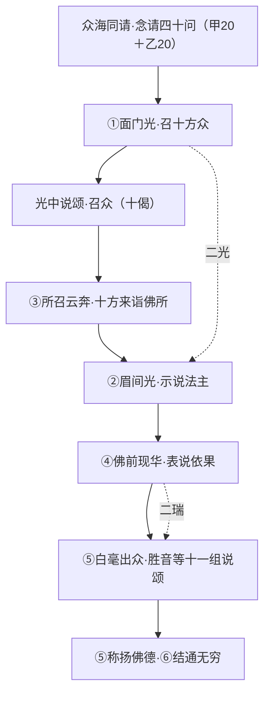

# 九九华严第二品 如来现相品之拼读

> 底本：唐·实叉难陀译《大方广佛华严经》（八十华严） T10n0279。范围：**卷第六（本品全一卷）**；卷第七另为《普贤三昧品第三》，仅作旁参（见 §三）。
> 立稿：2026-10-07（范围更正：2026-10-07，本品由原拟「卷六～七」订正为「卷六」）。
> 续补：L.122 —— 补 §1.1 品题释义、§6.1 面门光段（十光名）八十/六十对读、§6.2/§6.4 藏译对应品坐实（84000 编目）、§7.4 数据科学/叙事动画现状、附录四刷新。
> 校订（本批·审校）：`T0847`→`T10n0298`（§1.6 与 §6.4 统一）·§5.4.4 经文回源段订正（底本作「悉令发／咸令证」，勘正旧稿「皆令发／咸令正」之误）·§1.5 T2 出处作者补（萨尔吉）·§6.1 十光名用字（八十栏「燄」→「焰」，从底本）。
> 续补：L.125 —— 新增 **§2.7 说颂分·逐颂细读**（前导三颂＋勝音＋十大士＝十四组各十偈，全偈逐组回源 `T10n0279` 卷六）；**据实订正偈数之误**：前①「自然出音」颂旧记 2 偈实为 **10 偈**（旧法只数「。」，漏计以「！」「？」结句之偈），卷六说颂合计 132→**140 偈**；§2.6／附录二／§7.2／附录四同步，门禁增 H 段逐颂回源。
> 续补（本批）—— 新增 **§6.5 六十〈卢舍那佛品〉全量逐段对照**（总纲表＋十段齐备，二译全段对齐、逐字回源 `T09n0278`／`T10n0279`）；§6.1 附记／§6.2／§6.3／附录四之「六十全量逐段对照待补」皆改指 §6.5；门禁增 I 段。
> 原则：沿用第一品《世主妙严品》之校勘纪律、三层疏解（疏解／名相／会读）、存疑必标、推断必标「〔本文判断〕」、讲者之说疑误只标不改、三译主从分明、不擅改经文、可回源可复核

## 〇、凡例（简要）

一、**校勘底本**：以 T10n0279 为底本。六十华严（T09n0278）、四十华严（T10n0293）不作底本，但须品读并作对读；凡异译异说并列而不强断。
二、**品读主从**：以八十华严为叙事主轴，六十/四十为辅读与对读。主从仅指骨架取自何本，非谓其余可略。
三、**疏解三层**：其下「疏解」为依经文直解；「名相」为梵汉对勘、术语训释与异说并列；「会读」引本项目海云继梦法师讲记及相关资料，属一家之言，不冒充古注。
四、**引文从严**：引古注（澄观《大方广佛华严经随疏演义钞》T1736、《华严经疏》T1735、法藏《华严经探玄记》T1733、李通玄《新华严经论》T1739、《华严经合论》X0223）必注明经号与定位；未核到原文者不引，标〔待核〕。
五、**存疑与未竟**：一律如实标明〔待核〕〔存疑〕〔未竟〕，不掩其缺。
六、**中英对照**：名相依全站固定术语表；无通行对译者标〔no standard English equivalent〕，不强造译名。
七、**数字口径**：采用 scripts/miaoyan_metrics.py 式口径（剥离校勘记、按卷切分）先实测后定字数・句数，先统计「解脱门」「偈颂」后结论。
八、**残缺标识·信度随行**：凡经文有**残缺／短品／疑阙／增补**诸现象者，**如实标识**（〔缺文〕〔残〕〔短品〕〔疑阙〕〔补〕〔等〕，见 §1.5）＋**文献/法义说明**，并给出**信度评级**（T0–T3）；标识说「现象」、信度说「依据」，二者不同层，无从确证者只标〔疑阙〕不升断言。
九、**异本举而比之**：凡**藏译（Toh 44）、梵本、六十／四十**等**对应章节与本品有别**者，**不论用字、分品、文段有无、内容增减，悉举而比对**，注版本与信度；有异必注出处，未据原著者标〔待核〕，**严禁以「藏译云」冒充未见之原文**（详 §1.6、§6.4）。此为**长久沿用之惯例**。
十、**题名后缀**：本系列每篇标题（YAML `title`）一律以「**之拼读**」为后缀（九九华严第 N 品 OP之拼读），与第一部一致。

## 一、概述与品题解义

### 1.1 品题释义

**品名**：**如来现相品**（八十华严第二品，唐·实叉难陀译）。藏译（Toh 44）与之对应之品作 **`de bzhin gshegs pa`**（《如来》，Toh 44-2），品名较汉译为简〔据 84000 藏文《甘珠尔》编目，T2；详 §6.4〕。

**释名**（分「如来」「现相」「品」三节，据澄观《华严经疏》T1735，§5.1）：

- **「如来」——能现之人**。澄观：「**如來是能現之人**」，其义有五：一**就理显**（法性名如、出障名来）；二**唯就行**（「言无虚妄故名如来」）；三**理智合说**（「第一义谛名如，正觉名来」）；四**离相说**（「无所从来亦无所去」）；五**融摄说**（「一如无二如……是真如来」）。
- **「现相」——所现之法**。澄观：「**相是所現之法，現通能所能所合說**」——即「体用双陈以立其称」。本品所现之「相」有五：**面门光相**（召十方众）／**眉间光相**（示说法主）／**振动刹网**（警群机）／**佛前现华**（表说依果）／**白毫出众**（表教从佛流）。澄观谓「然如來現相**各有五義，以成其十**」——即如来五义（体）合现相五义（用）而成「十义」（§4.2／§5.1）。
- **「品」**——科段之目。此品为一品独立之经段（品次第二）。

**品名之辨（免与二品相混）**：华严一经中与「现相」相涉者不止一品，须分列（据《八十华严品卷对照表》，T0）：

| 品 | 品次·卷 | 相之义 | 海云一家之喻〔§5.4.2，T3〕 |
|----|---------|--------|------------------|
| **如来现相品** | 第二·卷六 | **小相**——一光召众·白毫出众 | 「果实已**搬到桌上**」 |
| 如来十身相海品 | 第三十四·卷四十八 | **大相**——十身相海之相 | 「**大相品**」 |
| 如来出现品 | 第三十七·卷五十–五十二 | 果成之事（「性起」） | 「果实在**树上成熟**」 |

〔辨〕本品**非**〈十身相海〉、**非**〈如来出现〉；然三品主题（现相·放光·佛身）相承，读本品者宜知此分际（海云之喻标为一家判读，非经证）。

**要义一字**：本品以一「**现**」字为骨——如来**不以言说，而以光相表示**（澄观「以光相表示为宗」）。故「现相」非现一固定之形相，乃**「大光明体」之显现**（海云 §5.4.2′，一家之说）；此与本品「法身为体、色形为用」诸偈（§2.3）正相印。全品骨节为「**念请→放光→云奔→现瑞→说颂**」，通篇不说一字正法，而借**光、声、华、毫**示之——此即华严「**理事无碍、重重无尽**」之开篇宣言（§1.7）。

### 1.2 品位与脉络（承上启下）

**在八十华严三十九品中之位**：第一品《世主妙严品》（卷一～五）为序分；**第二品《如来现相品》（卷六，一卷）为正说之始**（第三品《普贤三昧品》另占卷七）。清凉澄观判本品属第一会·菩提场会「举果劝乐生信分」；华严宗判位外诸家（如海云）则别立「序品独立」——**判位诸说并列，本细读不作独断**（详见 §5.1 澄观、§5.4 海云）。

**承上启下**：
- **承上**：《世主妙严品》「彰显佛境界之存在与殊胜」，为序；众海已集，主角未出。
- **本品**：如来现相（放光）→ 光召有缘·众海云奔 → 现瑞表说（眉间光、佛前现华、白毫出众）→ 称扬佛德；以「**光相表示**」为宗（澄观语），令上智玄悟为趣。
- **启下**：本品为「**果**」，第三品《普贤三昧品》为「**行**」——先果后行，由如来现相之果，转入普贤三昧之行（澄观、海云皆同此判读方向）。

**结构诸说**（供对读，勿强合）：
- 澄观 **六分**：众海同请／光召有缘／所召云奔／现瑞表说／称扬佛德／结通无穷（§5.1）。
- 法藏《探玄记》科判十门（面光集众分……正陈法海分，详见 §5.2）。
- 海云「三循环」说：第二品（果）→三十七品为一循环，三十八《离世间品》为第二、三十九《入法界品》为第三（§5.4，属一家之判）。

### 1.3 篇幅与结构预览（**本品＝卷第六**）

> **〔范围更正·据实记〕** 本稿初拟范围为「卷六～卷七」，经回核 `T10n0279` **经头品题**及《八十华严品卷对照表》，确认：**《如来现相品第二》仅佔卷第六**；**卷第七首即《普贤三昧品第三》**（同卷另有《世界成就品第四》）。故**本品范围订正为卷第六一卷**；卷第七非本品，另立 **§三 旁参** 收录（因海云「现相为果、三昧为行」之说二者相属，故附录之，然**严标其非本品**）。

- **本品范围**：卷第六（`T10n0279` 卷六，起「諸菩薩及一切世間主作是思惟」）。**实测 8,119 字／208 句**（CJK 剥校勘口径，详见 §7.1）。
- **品题对证**：卷六经首题「大方廣佛華嚴經卷第六……**如來現相品第二**」；卷七经首题「……**普賢三昧品第三**」。品卷对照表亦作：2 如来现相品＝6；3 普贤三昧品＝7。
- **结构骨架**（依澄观六分，参 §5.1）：①众海同请（念请）→②光召有缘→③所召云奔→④现瑞表说（眉间光·佛前现华·白毫出众）→⑤称扬佛德→⑥结通无穷。
- **旁参**：卷第七《普贤三昧品第三》（另见 §三，仅作相邻品参照，不入本品正文校勘）。

### 1.4 核心要义（十身・现相・光明・功德海）

本品为一会正说之始，其要义四（详 §2、§4）：
1. **现相**——如来不由言说，而**以光相表示**（澄观宗趣语）；「二光二瑞」＝面门光（召众）／眉间光（示说法主）／佛前现华／白毫出众（§2.2）。
2. **法身／色形**——本品不立「十身」名目，正宗在**法身为体、色形为用**：「佛身充滿於法界，普現一切眾生前」「法身同虛空……色形如影像」（§2.3）。
3. **光明**——**以光为教体**，光与音声不二（「一一毛孔中，光網遍十方……如来光明中，常出深妙音」）；光网重重即「一即一切」之教相化（§4.3）。
4. **功德海**——以「海」为量，承众海所问之「二十海」而答（§2.1、§2.4）。

### 1.5 经文文本之残缺、增补与信度标识（本文惯例·本批立）

> **缘起**：华严一经（乃至一切古译经）因**翻译、传抄、结集、版本**诸缘故，文本并非处处完整——有**品极短**者、有**文句段落似不完整**者、有**疑为后出增补**者（如本经「十定品」六十华严全无）。此等现象**当如实标识、系以注释与文献/法义说明，并给出信度评级**，不可默然而过，亦不可因「残缺」之名而横生揣测。

**标识符号集**（凡文中出现即附一句说明）：

| 标识 | 含义 | 例句 |
|------|------|------|
| 〔缺文〕 | 此处经文有**脱文/阙漏**（据校勘或版本比勘可证） | 某处文义中断，诸本皆阙 |
| 〔残〕 | **残卷/残句**（该处只存片段） | 支那内学院残卷 |
| 〔短品〕 | 本品篇幅**显著短于常例**（相对而言） | 本品 8,119 字（相对世主妙严品 31,953 字） |
| 〔疑阙〕 | **疑有阙文而未确**（存而不论） | — |
| 〔补〕/〔后人补〕 | **疑为后出增补**之文/品 | 十定品（六十华严阙） |
| 〔等〕 | 经文**固有之省略代表例**（非残缺，如「……如是等」） | 十光名「……如是等佛剎微塵數」 |

**信度评级**（沿用本项目三级来源评级，见 `verification-framework.md`）：

| 级 | 判据 | 例 |
|----|------|----|
| T0／一手 | 原典本身（CBETA 底本／一手抄本） | `T10n0279` 卷六文字 |
| T1／原典 | 同系统译本/注疏（异译、古注原本） | 六十华严、法藏《探玄记》 |
| T2／学术 | 同行评议论著、学术论文 | 萨尔吉《试论〈华严经〉的构成与流布》 |
| T3／二手 | 百科、官网、口说转述 | 维基、法师讲记听录 |

**说明**：标识表「文本现象」，信度表「判断依据」——**二者不同层**。凡标〔缺文〕〔补〕者，须注明**据何而断**（某本对勘／校记／学术论著），并给信度；**无从确证者只作〔疑阙〕／〔待核〕**，不升级为断言（与「考证优先」「严禁假信息」互证）。

**于本品之应用**（据实）：
- 本品并非「残缺品」，然**属〔短品〕**（8,119 字，短于世主妙严品）；此系**南宋以来**本品内容较少之事实，非脱文（V1 T0）。
- 本品**十光名、十方诸海**等处「……如是等」为**经文固有之〔等〕例**（省略代表），**非残缺**（T0，据底本文脉）。
- 本品在**六十华严无独立品名**（入〈卢舍那佛品〉）、**四十华严全无**——属**版本分合之差异**〔并存〕，非「缺」（V2/V3 T0/T1）。

### 1.6 版本差异之惯例（藏译・异本：若有异，悉举而比之·本批立）

> **惯例**：凡**藏译（Toh 44）、梵本残片、六十／四十华严**等**对应章节与本品有别**者——**不论其为用字、分品、文段有无、内容增减**——**悉举而比对之**，并注版本与信度。**无别者亦不妨标「与汉本大体同」**。此为**长久沿用之惯例**，非本品一次之特殊处理。

**三译／多本对照之判读原则**（承「多译本并存·考据成一」）：
1. **不可强求合一**——异本差异或为**传承不同**（于阗本 vs 梵本）、或为**译风不同**、或为**结集层次不同**，并列存之，注〔并存〕。
2. **有异必注出处**——凡言「藏译作 X」，须注明**据何**（藏文原典／学术论著／目录），无把握者标〔待核〕，**严禁以「藏译云」冒充未见之原文**。
3. **差异分层**——**分品差异**（如藏译 45 品 vs 汉 39 品）／**内容差异**（某段藏有汉无）／**用字差异**（译名异写）三层分列，不混。
4. **信度随源**——藏文原典为 T0/T1，学术转述为 T2，他说为 T3。

**本品之藏译情况**（据现有一手/二手材料，详 §6.4）：本品在藏译《华严经》（Toh 44，45 品）中**对应之品为第 2 品**，品名 `de bzhin gshegs pa`（义「如来」，据 84000 编目，T2；详 §6.2）。此外藏译**多出二品**为汉文三译所无／别见——第 11 品《如来华严品》（汉译全缺）、第 32 品《普贤宣说品》（汉有别译《大方广普贤所说经》`T10n0298`）；**然二品皆不紧邻本品**，详辨见 §6.4。

### 1.7 核心要义小结
本品以一「**现**」字为骨：**如来现相 → 众海现集 → 光现说 → 白毫现众**；通篇不说一字正法，而以**光相**示之，正是华严「**理事无碍、重重无尽**」之开篇宣言。

## 二、卷第六（如来现相品第二·本品全文）

### 2.1 序分／缘起（众海同请·「念请」四十问）

**经文（起本品）**：「爾時，諸菩薩及一切世間主，作是思惟：『云何是諸佛地？……』」——众海**以心念为请**（念请，非言请），发问二组、各二十：

- **甲组·二十（问佛之体用）**：「云何是諸佛**地／境界／加持／所行／力／無所畏／三昧／神通／自在／無能攝取／眼／耳／鼻／舌／身／意／身光／光明／聲／智**？」
- **乙组·二十（问诸「海」）**：「**世界海／眾生海／法界安立海／佛海／佛波羅蜜海／佛解脫海／佛變化海／佛演說海／佛名號海／佛壽量海**」＋「一切菩薩**誓願海／發趣海／助道海／乘海／行海／出離海／神通海／波羅蜜海／地海／智海**」。

**〔本批据经点定〕「四十问」＝甲 20 ＋ 乙 20 ＝ 四十**。此即海云所拈「四十个问题」之经文来历（§5.4.3），**由经文实点得出，非取口说**（承 §7.2 待办之解）。

**请辞**：「唯願世尊，哀愍我等，開示演說！」「願佛世尊，亦為我等，如是而說！」

**自然出音说颂（承念请）**：诸菩萨威神力故，**于一切供养具云中自然出音**而说颂——「无量劫中修行满，菩提树下成正觉，为度众生普现身，如云充遍尽未来／众生有疑皆使断，广大信解悉令发，无边际苦普使除，诸佛安乐咸令证……」颂中**重申所问**（诸佛地／如来境／加持／所行／三昧／无畏／神通／眼耳鼻舌身意／刹海众生海法界安立海佛海／解脱方便海法门海）。

**三层疏解**：
- *疏解*：本品不由佛「说」起，而由**众「念」请**起——正显华严「**请法为转法轮之因**」（海云「有请法就有转法轮」）。
- *名相*：「**念请**」＝以身语意中之意业为请；「**無能攝取**」〔待核〕（疑指佛之「无能制/无能摄」自在）。
- *会读*：海云以此四十问为「**疑情**」，劝置案头（§5.4.3）。

### 2.2 如来现相（光召·云奔·现瑞·表说）

本品之「现相」非一，**依经文可辨为「二光二瑞」**，恰与澄观「现相五义」对映（§5.1、§4.3）：

| 现相 | 经文（卷六） | 澄观「现相五义」 |
|------|------|------|
| ①面门光 | 041「即於**面門眾齒之間**，放佛剎微塵數光明」 | 一现面门光相，召十方众 |
| ②眉间光 | 124「放**眉間光**，此光名：一切菩薩智光明，普照耀十方藏」 | 二现眉间光相，示说法主 |
| ③振刹网 | 126「又普震動諸世界網，一一塵中現無數佛」 | 三振动刹网以警群机 |
| ④佛前现华 | 129「佛前有大蓮華，忽然出現，其華具有十種莊嚴」 | 四佛前现华表说依果 |
| ⑤白毫出众 | 132「於如來白毫相中，有菩薩摩訶薩，名：一切法勝音……俱時而出」 | 五白毫出众表教从佛流 |

**①光召有缘（041–043）**：世尊「知诸菩萨心之所念」，于**面门众齿间**放佛剎微尘数光明——**列十光名**：众宝华遍照、出种种音庄严法界、垂布微妙云、十方佛坐道场现神变、一切宝焰云盖、充满法界无碍、遍庄严一切佛剎、逈建立清净金刚宝幢、普庄严菩萨众会道场、妙音称扬一切佛名号……；一一复有佛剎微尘数光明为眷属；普照十方各一亿佛剎微尘数世界海；彼世界海菩萨众**于光明中，各得见此华藏庄严世界海**。

**②光中说颂召众（044–053）**：以佛神力，其光于彼菩萨众会前说颂（十颂），劝「汝等应往同瞻礼／汝可速诣如来所／汝可往观闻所说」。

**③所召云奔（054–134）**：十方世界海一切众会蒙光开觉，**各来诣毗卢遮那如来所，亲近供养**——十方各现世界海／国土／佛号／上首菩萨／供养云／坐座（详见 §2.5）。会中复**身毛孔现光明**、**念念中现诸法门开悟众生**（109–113）。

**④现瑞·表说（124–224）**：眉间光→佛前大莲华→白毫出众之**胜音菩萨**；胜音**领说一颂**，次第更有**十大士各说一颂**（**合十一组·各十偈**，逐组回源见 **§2.6**）。

**三层疏解**：
- *疏解*：全品骨为「**请→光→集→瑞→说**」，如来**不说一字**，而**以光相表示**（澄观宗趣语）——此即本宗教相之极致。
- *名相*：面门光 `mukha`（§5.2）；眉间光名「一切菩萨智光明，普照耀十方藏」。
- *会读*：海云「如来现相」＝**大光明体**，非有形之相（§5.4.2′）。

### 2.3 现相与法身（「十身说」辨正）

**〔辨正〕本品未见「十身」名目**（`T10n0279`「十身」3 见、「如来十身」2 见皆不在卷六，见 §4.1）。本品义理正宗在**法身／色形（色身）之对举**，为后世「十身」教义之**经证前身之一**，然不可径以「十身」填本品。

**关键偈（回源卷六）**：
- 胜音菩萨（135）：「**佛身充滿於法界，普現一切眾生前，隨緣赴感靡不周，而恒處此菩提座。**」（本品最脍炙人口之句）
- 观察一切胜法莲华光慧王（146–149）：「諸佛同法身，無依無差別，隨諸眾生意，令見佛色形。」「佛身及光明，色相不思議，眾生信樂者，隨應悉令見。」
- 法喜慧光明（159–161）：「佛身無有生，而能示出生，法性如虛空，諸佛於中住。」「無體無住處，亦無生可得，無相亦無形，所現皆如影。」
- 精进力无碍慧（240–241）：「法身同虛空，無礙無差別，色形如影像，種種眾相現。」「佛身不可取，無生無起作，應物普現前，平等如虛空。」

**义理**：**法身为体，色形为用**；「现相」即**体不碍用、应物现形**——身如影像，无相而现相。此与 §4.2「光相表示」、§5.1 澄观「能现／所现」一贯。

**名相**：法身 `dharmakāya`；色身／色形 `rūpakāya`／`rūpa`。

### 2.4 光明与功德海

- **二光**：面门光（召众）＋眉间光（示说法主）——见 §2.2 表。眉间光「其状犹如宝色灯云，遍照十方一切佛剎……随诸众生性欲不同，普雨三世一切诸佛妙法轮云」。
- **光中说颂（044–053）**：光自出声召众——「毛孔之中出化云，光明普照于十方，应受化者咸开觉」「如来一音无有量，能演契经深大海」——**光明与音声不二**。
- **毛孔光网（150）**：「一一毛孔中，光网遍十方，演佛妙音声，调彼难调者。」「如来光明中，常出深妙音，赞佛功德海。」
- **功德海**：偈中「无量劫中修行海，供养十方诸佛海，化度一切众生海」（044）「赞佛功德海，及菩萨所行」（151）——以「海」为量，即本品「诸海」之问之答（呼应 §2.1 乙组二十海）。

**名相**：`raśmi`（光）／`prabhā`（光辉）；「光网」拟 `raśmi-jāla`〔待核〕。

### 2.5 菩萨众及住处（十方世界海）

**所召云奔之十方**（回源卷六，逐方世界海／国土／佛号／上首菩萨，据经文摘录）：

| 方 | 世界海 | 国土 | 佛号 | 上首菩萨 |
|----|--------|------|------|----------|
| 东 | 清净光莲华庄严 | 摩尼璎珞金刚藏 | 法水觉虚空无边王 | 观察胜法莲华幢 |
| 南 | 一切宝月光明庄严藏 | 无边光圆满庄严 | 普智光明德须弥王 | 普照法海慧 |
| 西 | 可爱乐宝光明 | 出生上妙资身具 | 香焰功德宝庄严 | 月光香焰普庄严 |
| 北 | 毗琉璃莲华光圆满藏 | 优钵罗华庄严 | 普智幢音王 | 师子奋迅光明 |
| 东北 | 阎浮檀金玻璃色幢 | 众宝庄严 | 一切法无畏灯 | 最胜光明灯无尽功德藏 |
| 东南 | 金庄严琉璃光普照 | 清净香光明 | 普喜深信王 | 慧灯普明 |
| 西南 | 日光遍照 | 师子日光明 | 普智光明音 | 普华光焰髻 |
| 西北 | 宝光照耀 | 众香庄严 | 无量功德海光明 | 无尽光摩尼王 |
| 下 | 莲华香妙德藏 | 宝师子光明照耀 | 法界光明 | 法界光焰慧 |
| 上 | 摩尼宝照耀庄严 | 无相妙光明 | 无碍功德光明王 | 无碍力精进慧 |

**规模**：如是十亿佛剎微尘数世界海中，有**十亿佛剎微尘数菩萨**，一一各有世界海微尘数菩萨众前后围绕而来集会；一一各现世界海微尘数供养云；坐定已，身毛孔中一一各现十世界海微尘数光明（105–109）。

**本会说法之菩萨（承佛威神/威力，次第说颂·逐组起句与偈数见 §2.6）**：
- **一切法胜音**（白毫出众）：颂「佛身充满于法界……」
- 次第：观察一切胜法莲华光慧王／法喜慧光明／香焰光普明慧／师子奋迅慧光明／法海慧功德藏／慧灯普明／华焰髻普明智／威德慧无尽光／法界普明慧／精进力无碍慧（**十大士**，各一颂）。
- 〔**注**〕上述诸菩萨名与 §2.5 表中「上首菩萨」**部分同名而异**（如「慧灯普明」既为东南上首、又为会说颂主），系经文「同名」之例，**非笔误**，据实并记。
**会读**：华严会众「**位次不滥、重重相应**」——十方各带其世界海之佛、土、众而来，正是「一即一切」之众会观。

### 2.6 偈颂支分总表（逐颂标定·据经切分）

**方法**：取 `T10n0279` **卷第六**纯文本（剥标签），以「…而說頌言／而說頌曰／說此頌言」为切分点，逐组以**句数**计偈（每偈四句，**凡句末作「。」「！」「？」者皆计为一句**，合四句成一偈）；**先实测后结论**，数目皆自经文点出，非估。

〔**方法订正·据实记**〕旧法「以『。』数计偈」有**系统性漏计**——凡以「！」（赞、劝）或「？」（问）结句之偈，其末句非「。」，遂被漏计。**前①「自然出音」颂**后半之「念请偈」多以「！」「？」收，旧记仅 **2 偈**，据底本实测实为 **40 句＝10 偈**（详 §2.7.1 勘误）。今改以**句末标点（。！？）全计**，逐组复校；复校后**十四组体例齐整、各组皆十偈**（前① 独异之旧记本与全品体例不谐）。

**（一）前导三颂**（眉间光之前）

| 序 | 出处 | 起句 | 偈数 |
|----|------|------|------|
| 前①| 自然出音（承「念请」） | 無量劫中修行滿，菩提樹下成正覺…… | **10**〔勘误〕 |
| 前② | 面门光·光中说颂（众会前） | 無量劫中修行海，供養十方諸佛海…… | **10** |
| 前③ | 光中同时发声（云奔后） | 諸光明中出妙音，普遍十方一切國…… | **10** |

**眉间光后·胜音领颂＋十大士各一颂**（皆「承佛威神／威力，观察十方而说颂」）：

| 序 | 说法者 | 起句 | 偈数 |
|----|------|------|------|
| 1 | 一切法胜音（白毫出众） | 佛身充滿於法界，普現一切眾生前…… | 10 |
| 2 | 观察一切胜法莲华光慧王 | 如來甚深智，普入於法界…… | 10 |
| 3 | 法喜慧光明 | 佛身常顯現，法界悉充滿…… | 10 |
| 4 | 香焰光普明慧 | 此會諸菩薩，入佛難思地…… | 10 |
| 5 | 师子奋迅慧光明 | 毘盧遮那佛，能轉正法輪…… | 10 |
| 6 | 法海慧功德藏 | 此會諸佛子，善修眾智慧…… | 10 |
| 7 | 慧灯普明 | 一切諸如來，遠離於眾相…… | 10 |
| 8 | 华焰髻普明智 | 一切國土中，普演微妙音…… | 10 |
| 9 | 威德慧无尽光 | 一一佛剎中，處處坐道場…… | 10 |
| 10 | 法界普明慧 | 如來微妙身，色相不思議…… | 10 |
| 11 | 精进力无碍慧 | 佛演一妙音，周聞十方剎…… | 10 |

**统计**：前导三颂 ＝ **30 偈**（10＋10＋10）；眉间光后 **11 组 × 10 偈 ＝ 110 偈**。卷六偈颂合计 **140 偈**（140 偈 ÷ 4 ＝ 560 句偈行；与 §7.2 之「208 句」为**两种口径**，句含散文，不可互校）。

**〔勘误·据实记〕**：旧稿计卷六偈颂 **132 偈**（＝「前① 2」＋10＋10＋110），系**前① 计数之误**（只数「。」漏计「！？」结句之偈，见 §2.6 方法订正）所致；据底本实测订正为 **140 偈**。**旧数 132 一律作废**，勿再沿用（§7.2／附录二／附录四已同步；门禁 B 段扫描「132 偈」回潮）。

**〔编制说明·一处旧说订正〕**：旧稿称「**十大士颂（135–224）**」「**十菩萨**承佛威神说颂」，其数系**以胜音之后之十位计**；然依经文实点，**眉间光后说颂之主共十一位**——**胜音领一颂，次第更有十大士各一颂**，合十一组。故本文改述为「**胜音＋十大士（十一组）**」，以免「十」字含混（承 §7.2「先统计后结论」之例）。其起句、偈数皆**逐组回源 `T10n0279` 卷六**点出，非估数。

### 2.7 说颂分·逐颂细读（前导三颂＋勝音＋十大士·十四组·各十偈）

**〔本批新增·承 §2.6〕** 本品说颂凡**十四组**（前导三颂＋勝音＋十大士），**各组皆十偈**（据 §2.6 方法订正、逐组复校）。本节逐组**全文细读**——先列**逐字回源 `T10n0279` 卷六**之偈颂原文（每四句为一偈，以「／」分隔），次作**疏解**（依文直解）、**名相**（术语训释）；名相之梵语凡无本经梵本可据者，一律标〔待核〕，不强造（凡例六）。

**〔勘误·据实记〕**：前①「自然出音」颂，§2.6 旧记「**2 偈**」系**计数之误**——旧法只数句末「。」，而此颂后半之「念请偈」多以「！」（赞、劝）「？」（问）收，遂被漏计；据底本实测**该颂凡 40 句＝10 偈**。故**前导三颂＝30 偈**，卷六说颂合计订正为 **140 偈**（旧记 132 作废，§2.6 已同步）。此正见 §2.6 之体例：**十四组齐整，各组十偈**。

#### 2.7.1 前① 自然出音颂（10 偈）

> 無量劫中修行滿，菩提樹下成正覺，為度眾生普現身，如雲充遍盡未來。／眾生有疑皆使斷，廣大信解悉令發，無邊際苦普使除，諸佛安樂咸令證。／菩薩無數等剎塵，俱來此會同瞻仰，願隨其意所應受，演說妙法除疑惑！／云何了知諸佛地？云何觀察如來境？佛所加持無有邊，願示此法令清淨！／云何是佛所行處，而以智慧能明入？佛力清淨廣無邊，為諸菩薩應開示！／云何廣大諸三昧？云何淨治無畏法？神通力用不可量，願隨眾生心樂說！／諸佛法王如世主，所行自在無能制，及餘一切廣大法，為利益故當開演！／佛眼云何無有量？耳鼻舌身亦復然？意無有量復云何？願示能知此方便！／如諸剎海眾生海，法界所有安立海，及諸佛海亦無邊，願為佛子咸開暢！／永出思議眾度海，普入解脫方便海，所有一切法門海，此道場中願宣說！

**疏解**：此颂为「念请」之**音声化**——诸供养具云中自然出音，代众请法。前三偈（無量劫中修行滿／眾生有疑皆使斷／菩薩無數等剎塵）**赞佛果德已成、众机已集**；第三偈末「願隨其意所應受，演說妙法除疑惑」为一颂之枢纽，点出请法之旨。**后七偈**（云何了知諸佛地……）逐项重陈长行所问——与 §2.1 甲组「问佛体用」二十问**同位而异出**（此以偈颂出之，彼以长行问之），足见本品「**由念入音、由音召光**」之次第。
**名相**：**自然出音**——诸菩萨威神力所感，非佛口说（本文依文直解）；**如雲充遍**——喻佛身／化身之普现（§2.3）。

#### 2.7.2 前② 面门光中说颂（10 偈）

> 無量劫中修行海，供養十方諸佛海，化度一切眾生海，今成妙覺遍照尊。／毛孔之中出化雲，光明普照於十方，應受化者咸開覺，令趣菩提淨無礙。／佛昔往來諸趣中，教化成熟諸群生，神通自在無邊量，一念皆令得解脫。／摩尼妙寶菩提樹，種種莊嚴悉殊特，佛於其下成正覺，放大光明普威耀。／大音震吼遍十方，普為弘宣寂滅法，隨諸眾生心所樂，種種方便令開曉。／往修諸度皆圓滿，等於千剎微塵數，一切諸力悉已成，汝等應往同瞻禮。／十方佛子等剎塵，悉共歡喜而來集，已雨諸雲為供養，今在佛前專覲仰。／如來一音無有量，能演契經深大海，普雨妙法應群心，彼兩足尊宜往見。／三世諸佛所有願，菩提樹下皆宣說，一剎那中悉現前，汝可速詣如來所。／毘盧遮那大智海，面門舒光無不見，今待眾集將演音，汝可往觀聞所說。

**疏解**：此颂由**面门光**发出，主旨在「**召劝**」——前十方菩萨于光中得见华藏世界海，此颂复令彼众闻之而来集，故屡作「**汝等應往同瞻禮**」「**汝可速詣如來所**」「**汝可往觀聞所說**」之劝。偈1（無量劫中修行海……今成妙覺遍照尊）赞佛因圆果满；偈2－5（毛孔之中出化雲……大音震吼遍十方）明佛光云普照、往昔教化、成道放光、大音说法；偈6－10以「往修诸度」「如来一音」「三世诸佛所有愿」「毘盧遮那大智海」四面收摄，末句「**今待眾集將演音**」紧接下文眉间光与说颂（与 §6.1 〇′／① 之次序注合观）。
**名相**：**面門**——放光处（面门众齿之间，§6.1 〇′；法藏释面·口·门三义，§5.2）；**妙覺**——佛果之号。

#### 2.7.3 前③ 光中同时发声颂（10 偈）

> 諸光明中出妙音，普遍十方一切國，演說佛子諸功德，能入菩提之妙道。／劫海修行無厭倦，令苦眾生得解脫，心無下劣及勞疲，佛子善入斯方便。／盡諸劫海修方便，無量無邊無有餘，一切法門無不入，而恒說彼性寂滅。／三世諸佛所有願，一切修治悉令盡，即以利益諸眾生，而為自行清淨業。／一切諸佛眾會中，普遍十方無不往，皆以甚深智慧海，入彼如來寂滅法。／一一光明無有邊，悉入難思諸國土，清淨智眼普能見，是諸菩薩所行境。／菩薩能住一毛端，遍動十方諸國土，不令眾生有怖想，是其清淨方便地。／一一塵中無量身，復現種種莊嚴剎，一念沒生普令見，獲無礙意莊嚴者。／三世所有一切劫，一剎那中悉能現，知身如幻無體相，證明法性無礙者。／普賢勝行皆能入，一切眾生悉樂見，佛子能住此法門，諸光明中大音吼。

**疏解**：此颂为诸菩萨**光明中同时发声**（逐字对读见 §6.1 ①′），与前②皆「光中说颂」而同在眉间光之前。颂以「**光**」与「**音**」为纲——首偈「諸光明中出妙音」标体；中诸偈（劫海修行無厭倦……普賢勝行皆能入）赞菩萨**难行能行、一毛遍动、尘现众刹、如幻无体**之境；末偈「諸光明中大音吼」归音声说法，与本品「光相表示」之旨相成。
**名相**：**大音吼**——佛／菩萨说法之喻（师子吼类）。

#### 2.7.4 勝音组·一切法勝音（10 偈）

> 佛身充滿於法界，普現一切眾生前，隨緣赴感靡不周，而恒處此菩提座。／如來一一毛孔中，一切剎塵諸佛坐，菩薩眾會共圍遶，演說普賢之勝行。／如來安處菩提座，一毛示現多剎海，一一毛現悉亦然，如是普周於法界。／一一剎中悉安立，一切剎土皆周遍，十方菩薩如雲集，莫不咸來詣道場。／一切剎土微塵數，功德光明菩薩海，普在如來眾會中，乃至法界咸充遍。／法界微塵諸剎土，一切眾中皆出現，如是分身智境界，普賢行中能建立。／一切諸佛眾會中，勝智菩薩僉然坐，各各聽法生歡喜，處處修行無量劫。／已入普賢廣大願，各各出生眾佛法，毘盧遮那法海中，修行克證如來地。／普賢菩薩所開覺，一切如來同讚喜，已獲諸佛大神通，法界周流無不遍。／一切剎土微塵數，常現身雲悉充滿，普為眾生放大光，各雨法雨稱其心。

**疏解**：勝音为**白毫出众**之首，其颂总摄「**法身为体、现相为用**」。首偈「**佛身充滿於法界，普現一切眾生前，隨緣赴感靡不周，而恒處此菩提座**」为全品最脍炙之句——佛身遍一切处而恒居菩提座，即「**不动而遍应**」、体用不二（§2.3）。次以「毛孔现佛」「一毛现多剎海」「一一剎中悉安立」彰「**一即一切**」；「普賢菩薩所開覺」归众行；末偈「各雨法雨稱其心」以应机收。（此组首偈对读已见 §6.1 ②′。）
**名相**：**法界**（dharmadhātu）；**菩提座**（bodhimaṇḍa 之拟，〔待核〕）。

#### 2.7.5 观察一切胜法莲华光慧王（10 偈）

> 如來甚深智，普入於法界，能隨三世轉，與世為明導。／諸佛同法身，無依無差別，隨諸眾生意，令見佛色形。／具足一切智，遍知一切法，一切國土中，一切無不現。／佛身及光明，色相不思議，眾生信樂者，隨應悉令見。／於一佛身上，化為無量佛，雷音遍眾剎，演法深如海。／一一毛孔中，光網遍十方，演佛妙音聲，調彼難調者。／如來光明中，常出深妙音，讚佛功德海，及菩薩所行。／佛轉正法輪，無量無有邊，所說法無等，淺智不能測。／一切世界中，現身成正覺，各各起神變，法界悉充滿。／如來一一身，現佛等眾生，一切微塵剎，普現神通力。

**疏解**：此组以「**智**」为宗。首偈「**如來甚深智，普入於法界**」标佛智遍入；偈1－2「諸佛同法身，無依無差別，隨諸眾生意，令見佛色形」明**法身无差别而随缘现色形**（§2.3／§6.1 ②）；偈5－6「於一佛身上，化為無量佛」「一一毛孔中，光網遍十方」明**一即一切**；末偈「如來一一身，現佛等眾生」以分身遍现收。（法身／色形之全偈归类见 §2.3。）
**名相**：**法身**（dharma-kāya）——诸佛同体、无依无差别；**明導**——佛为世之导首。

#### 2.7.6 法喜慧光明（10 偈）

> 佛身常顯現，法界悉充滿，恒演廣大音，普震十方國。／如來普現身，遍入於世間，隨眾生樂欲，顯示神通力。／佛隨眾生心，普現於其前，眾生所見者，皆是佛神力。／光明無有邊，說法亦無量，佛子隨其智，能入能觀察。／佛身無有生，而能示出生，法性如虛空，諸佛於中住。／無住亦無去，處處皆見佛，光明靡不周，名稱悉遠聞。／無體無住處，亦無生可得，無相亦無形，所現皆如影。／佛隨眾生心，為興大法雲，種種方便門，示悟而調伏。／一切世界中，見佛坐道場，大眾所圍遶，照耀十方國。／一切諸佛身，皆有無盡相，示現雖無量，色相終不盡。

**疏解**：此组以「**无生而现**」为骨。偈1「佛身常顯現，法界悉充滿」标遍；偈5「**佛身無有生，而能示出生，法性如虛空**」、偈7「**無體無住處，亦無生可得，無相亦無形，所現皆如影**」为「**影像**」说之要语（§2.3），明佛身无相而随缘现相；末二偈（一切世界中見佛坐道場／一切諸佛身皆有無盡相）归「色相无尽」。
**名相**：**如影**——喻所现无实体（同 §6.1 ②「色形如影像」）。

#### 2.7.7 香焰光普明慧（10 偈）

> 此會諸菩薩，入佛難思地，一一皆能見，一切佛神力。／智身能遍入，一切剎微塵，見身在彼中，普見於諸佛。／如影現眾剎，一切如來所，於彼一切中，悉現神通事。／普賢諸行願，修治已明潔，能於一切剎，普見佛神變。／身住一切處，一切皆平等，智能如是行，入佛之境界。／已證如來智，等照於法界，普入佛毛孔，一切諸剎海。／一切佛國土，皆現神通力，示現種種身，及種種名號。／能於一念頃，普現諸神變，道場成正覺，及轉妙法輪。／一切廣大剎，億劫不思議，菩薩三昧中，一念皆能現。／一切諸佛土，一一諸菩薩，普入於佛身，無邊亦無盡。

**疏解**：此组以「**此会菩萨**」为说主，转赞**因行**（异于前诸组之赞果）。首偈「此會諸菩薩，入佛難思地」标众位；偈2「智身能遍入，一切剎微塵」、偈3「如影現眾剎」明智身遍入；偈4－5以「普賢諸行願」「身住一切處，一切皆平等」明行愿平等；末偈「普入於佛身，無邊亦無盡」归**互入无尽**。
**名相**：**難思地**——菩萨不可思议之地（acintya-bhūmi 之拟，〔待核〕）；**智身**——菩萨以智为身。

#### 2.7.8 师子奋迅慧光明（10 偈）

> 毘盧遮那佛，能轉正法輪，法界諸國土，如雲悉周遍。／十方中所有，諸大世界海，佛神通願力，處處轉法輪。／一切諸剎土，廣大眾會中，名號各不同，隨應演妙法。／如來大威力，普賢願所成，一切國土中，妙音無不至。／佛身等剎塵，普雨於法雨，無生無差別，現一切世間。／無數諸億劫，一切塵剎中，往昔所行事，妙音咸具演。／十方塵國土，光網悉周遍，光中悉有佛，普化諸群生。／佛身無差別，充滿於法界，能令見色身，隨機善調伏。／三世一切剎，所有眾導師，種種名號殊，為說皆令見。／過未及現在，一切諸如來，所轉妙法輪，此會皆得聞。

**疏解**：此组以「**转法轮**」为轴。首偈「**毘盧遮那佛，能轉正法輪，法界諸國土，如雲悉周遍**」标主；偈2－4明诸世界海、众会、名号各别而妙音皆遍；偈7「十方塵國土，光網悉周遍，光中悉有佛」明光中现佛说法；末偈「**過未及現在，一切諸如來，所轉妙法輪，此會皆得聞**」以三世佛轮之「遍闻」收——正显「一会即一切会」之华严境。
**名相**：**轉正法輪**——说法度生（梵 cakra 之喻）。

#### 2.7.9 法海慧功德藏（10 偈）

> 此會諸佛子，善修眾智慧，斯人已能入，如是方便門。／一一國土中，普演廣大音，說佛所行處，周聞十方剎。／一一心念中，普觀一切法，安住真如地，了達諸法海。／一一佛身中，億劫不思議，修習波羅蜜，及嚴淨國土。／一一微塵中，能證一切法，如是無所礙，周行十方國。／一一佛剎中，往詣悉無餘，見佛神通力，入佛所行處。／諸佛廣大音，法界靡不聞，菩薩能了知，善入音聲海。／劫海演妙音，其音等無別，智周三世者，入彼音聲地。／眾生所有音，及佛自在聲，獲得音聲智，一切皆能了。／從地而得地，住於力地中，億劫勤修行，所獲法如是。

**疏解**：此组以「**音声**」为纲。首偈「此會諸佛子，善修眾智慧」标众；偈3「一一心念中，普觀一切法，安住真如地，了達諸法海」明**一念普观**；偈7「**諸佛廣大音，法界靡不聞，菩薩能了知，善入音聲海**」、偈8「劫海演妙音，其音等無別」明「**音声**」之平等周遍——与本品「光／音」二门相成；末偈「從地而得地……所獲法如是」归行位。
**名相**：**音聲海**——佛说法音之无尽（喻海）；**真如地**——所安住之理地。

#### 2.7.10 慧灯普明（10 偈）

> 一切諸如來，遠離於眾相，若能知是法，乃見世導師。／菩薩三昧中，慧光普明了，能知一切佛，自在之體性。／見佛真實體，則悟甚深法，普觀於法界，隨願而受身。／從於福海生，安住於智地，觀察一切法，修行最勝道。／一切佛剎中，一切如來所，如是遍法界，悉見真實體。／十方廣大剎，億劫勤修行，能游正遍知，一切諸法海。／唯一堅密身，一切塵中見，無生亦無相，普現於諸國。／隨諸眾生心，普現於其前，種種示調伏，速令向佛道。／以佛威神故，出現諸菩薩，佛力所加持，普見諸如來。／一切眾導師，無量威神力，開悟諸菩薩，法界悉周遍。

**疏解**：此组以「**离相**」为宗。首偈「**一切諸如來，遠離於眾相，若能知是法，乃見世導師**」直标「**离相乃见佛**」；偈2－4以「三昧慧光」「見佛真實體」明由定发慧、见真实体；偈7「**唯一堅密身，一切塵中見，無生亦無相，普現於諸國**」明「**坚密身**」遍尘——法身之坚密（异于色相之生灭）；末偈「開悟諸菩薩，法界悉周遍」归法界遍。
**名相**：**堅密身**——法身之喻（坚不可坏、密不可分）；**正遍知**（samyak-saṃbuddha 之汉译）。

#### 2.7.11 华焰髻普明智（10 偈）

> 一切國土中，普演微妙音，稱揚佛功德，法界悉充滿。／佛以法為身，清淨如虛空，所現眾色形，令入此法中。／若有深信喜，及為佛攝受，當知如是人，能生了佛智。／諸有少智者，不能知此法，慧眼清淨人，於此乃能見。／以佛威神力，觀察一切法，入住及出時，所見皆明了。／一切諸法中，法門無有邊，成就一切智，入於深法海。／安住佛國土，出興一切處，無去亦無來，諸佛法如是。／一切眾生海，佛身如影現，隨其解差別，如是見導師。／一切毛孔中，各各現神通，修行普賢願，清淨者能見。／佛以一一身，處處轉法輪，法界悉周遍，思議莫能及。

**疏解**：此组以「**法身如虚空**」为骨。偈2「**佛以法為身，清淨如虛空，所現眾色形，令入此法中**」直标「**法为身**」；偈3－4劝信（「若有深信喜……能生了佛智」「慧眼清淨人，於此乃能見」）；偈7「安住佛國土，出興一切處，**無去亦無來**」明**法身之无去来**；末偈「佛以一一身，處處轉法輪……思議莫能及」极言不可思议。
**名相**：**法身**——以法为身、清净如空（dharma-kāya）；**深法海**——甚深法之无尽。

#### 2.7.12 威德慧无尽光（10 偈）

> 一一佛剎中，處處坐道場，眾會共圍遶，魔軍悉摧伏。／佛身放光明，遍滿於十方，隨應而示現，色相非一種。／一一微塵內，光明悉充滿，普見十方土，種種各差別。／十方諸剎海，種種無量剎，悉平坦清淨，帝青寶所成。／或覆或傍住，或似蓮華合，或圓或四方，種種眾形相。／法界諸剎土，周行無所礙，一切眾會中，常轉妙法輪。／佛身不思議，國土悉在中，於其一切處，導世演真法。／所轉妙法輪，法性無差別，依於一實理，演說諸法相。／佛以圓滿音，闡明真實理，隨其解差別，現無盡法門。／一切剎土中，見佛坐道場，佛身如影現，生滅不可得。

**疏解**：此组以「**剎土与法**」为主。偈1「一一佛剎中，處處坐道場……**魔軍悉摧伏**」明降魔成道；偈4－5（十方諸剎海……**或覆或傍住，或似蓮華合，或圓或四方**）广陈**刹土形相**（覆／傍、莲华合、圆方），为诸家所重之「华藏形相」描写；偈8「**所轉妙法輪，法性無差別，依於一實理，演說諸法相**」明「**依理成事**」之教；末偈「佛身如影現，生滅不可得」归影像。
**名相**：**一實理**——唯一真实之理；**法性**（dharmatā）——诸法本性，无差别。

#### 2.7.13 法界普明慧（10 偈）

> 如來微妙身，色相不思議，見者生歡喜，恭敬信樂法。／佛身一切相，悉現無量佛，普入十方界，一一微塵中。／十方國土海，無量無邊佛，咸於念念中，各各現神通。／大智諸菩薩，深入於法海，佛力所加持，能知此方便。／若有已安住，普賢諸行願，見彼眾國土，一切佛神力。／若人有信解，及以諸大願，具足深智慧，通達一切法。／能於諸佛身，一一而觀察，色聲無所礙，了達於諸境。／能於諸佛身，安住智所行，速入如來地，普攝於法界。／佛剎微塵數，如是諸國土，能令一念中，一一塵中現。／一切諸國土，及以神通事，悉現一剎中，菩薩力如是。

**疏解**：此组以「**信解入法**」为主。首偈赞「如來微妙身，色相不思議」；偈2－3「佛身一切相，悉現無量佛，普入十方界，一一微塵中」明**一相现多**；偈4－8层层示行位——「大智諸菩薩……」「若能信解／安住普賢諸行願……」终至「速入如來地，**普攝於法界**」；末偈「佛剎微塵數……能令一念中，一一塵中現」归「**一念遍现**」。
**名相**：**普攝於法界**——一行遍摄一切（华严「行布不碍圆融」之经证）。

#### 2.7.14 精進力無礙慧（10 偈）

> 佛演一妙音，周聞十方剎，眾音悉具足，法雨皆充遍。／一切言辭海，一切隨類音，一切佛剎中，轉於淨法輪。／一切諸國土，悉見佛神變，聽佛說法音，聞已趣菩提。／法界諸國土，一一微塵中，如來解脫力，於彼普現身。／法身同虛空，無礙無差別，色形如影像，種種眾相現。／影像無方所，如空無體性，智慧廣大人，了達其平等。／佛身不可取，無生無起作，應物普現前，平等如虛空。／十方所有佛，盡入一毛孔，各各現神通，智眼能觀見。／毘盧遮那佛，願力周法界，一切國土中，恒轉無上輪。／一毛現神變，一切佛同說，經於無量劫，不得其邊際。

**疏解**：此为白毫出众说颂之**末组**。颂以「**一音**」起、「**无碍**」收——偈1「佛演一妙音，周聞十方剎，眾音悉具足，法雨皆充遍」明「**一音具众音**」；偈5「**法身同虛空，無礙無差別，色形如影像，種種眾相現**」、偈6「影像無方所，如空無體性」为「法身／影像」之最要语（§2.3／§6.1 ②）；偈8「十方所有佛，盡入一毛孔」明**互入**；末偈「一毛現神變，一切佛同說，經於無量劫，**不得其邊際**」以**无尽**收束整品说颂。
**名相**：**無礙**（apratihata 之拟，〔待核〕）——一多相即、互摄无碍。

#### 2.7.15 说颂分小结（义理脉络）

十四组说颂可按「**请·召—赞佛果德—显因行·归无碍**」三段观：
- **前导三颂**（2.7.1–3）主「**请**」与「**召**」——由自然出音之请，继而面门光中说颂、光明中同时发声（皆在眉间光前）；
- **勝音＋诸大士**（2.7.4–13）主「**赞佛果德**」——法身遍应（勝音）、智入法界、离相坚密、转轮周遍、法身如空、刹土依理、信解普摄；
- **末组精进力无碍慧**（2.7.14）主「**归无碍**」——一音具众音、影像如空、无尽收束。

综观：本品虽「**如来不吐一字正法**」（§2.2／§5.1），然**问端**由念而音（前①）、**召劝**由光而音（前②③）、**果德**由白毫出众之众而颂（勝音十大士）——「**现相**」之旨，于此十四组、一百四十偈中说尽。〔经文一律不改不補不臆；各组偈颂逐字回源 `T10n0279` 卷六，门禁 H 段校验。〕

## 三、旁参：卷第七（**非本品**）

> **〔旁参非本品〕** 卷第七首为《普贤三昧品第三》，**不属《如来现相品》**。**（考）** 卷七实含**二品**——前半《普贤三昧品第三》＋后半《世界成就品第四》；据 `T10n0279` 卷七经头小题（「3普賢三昧品第三」接「4世界成就品第四」）与卷八首《華藏世界品第五之一》，`<cb:juan n="007">` 区块止于世界成就品末颂「以願力故遍世間」。因海云以「如来现相为果，普贤三昧为行」二者相属（详见 §5.4），故节录为**相邻品参照**，不入本品逐段校勘。欲详究第三品者，宜另立专篇。

### 3.1 普贤三昧品（第三品）节录·参照

**经文起（卷七，`T10n0279`）**：

> 「爾時，普賢菩薩摩訶薩於如來前，坐蓮華藏師子之座，承佛神力，入于三昧。此三昧名：一切諸佛毘盧遮那如來藏身，普入一切佛平等性，能於法界示眾影像……」

**与本品之关系**：本品（第二）为「**果**」（如来现相）之展示，第三品为「**行**」（普贤入三昧）之起手——海云判「如来现相是果，普贤三昧是行；先果后行」（§5.4.1）。故第三品虽非本品，读本品者宜知此**果行相续**之势。

### 3.2 结构与偈颂支分（先统计后结论）

**本体次第**（卷七前半·`T10n0279`，实测 CJK **1,995 字**）：①普贤于如来前坐莲华藏师子座，承佛神力入「一切诸佛毗卢遮那如来藏身」三昧（**「解脫門」0 见**，异于第一品之 442 见）→②一一普贤皆现十方一切诸佛于前，同声讚言「善哉！善哉」→③十方诸佛与普贤十种智、各舒右手摩顶→④普贤从三昧起，从「一切世界海微尘数三昧海门」起（经列**九门**，如知三世念念无差别善巧智三昧门等）→⑤诸菩萨各得**九种**世界海微尘数海云（三昧海云、陀罗尼海云、诸法方便海云、辩才门海云、修行海云、普照法界一切如来功德藏智光明海云、一切如来诸力智慧无差别方便海云、一一毛孔中各现众刹海云、示现从兜率天宫没下生成佛转法轮般涅槃等海云）→⑥十方一切世界海**悉皆微动**、普雨**十种大摩尼王云**→⑦一切如来诸毛孔中咸放光明，**于光明中而说颂言**→⑧一切菩萨同声赞普贤。

**偈颂支分总表**（逐颂标定·据经切分）：

| 序 | 说颂出处 | 偈数 | 首句 | 末句 |
|----|----------|------|------|------|
| 一 | 一切如来诸毛孔光中（**光中颂**） | 10 | 普賢遍住於諸剎 | 佛光雲中讚功德 |
| 二 | 一切菩萨同声（**众赞颂**·承佛神力） | 10 | 從諸佛法而出生 | 一切諸佛皆隨喜 |
| — | **合计** | **20** | | |

**光中颂首偈**（一切如来诸毛孔光中说）：

> 「普賢遍住於諸剎，坐寶蓮華眾所觀，一切神通靡不現，無量三昧皆能入。」

**众赞颂首偈**（一切菩萨同声赞普贤）：

> 「從諸佛法而出生，亦因如來願力起，真如平等虛空藏，汝已嚴淨此法身。」

〔**口径**〕两颂皆**十偈**（四句一偈），合计 **20 偈**；与本品「前②③光中出颂各 10 偈」「胜音＋十大士十一组各 10 偈」之格同（§2.6）。第三品**「解脫門」仍 0 见**——故「组组有门」之框架，卷一之后诸品皆不可套用（同 L.106 卷五「门≠偈」之教训）。

### 3.3 品末结归·请转法轮

第三品结尾，众赞之后复以**请法**收束——以「国土云何得成立？诸佛云何而出现？及以一切众生海？愿随其义如实说」请普贤转法轮，正为下品《世界成就品第四》之引子：

> 「國土云何得成立？諸佛云何而出現？及以一切眾生海？願隨其義如實說。」

故**第三品与第四品为一段**（请法→普贤说世界海十事），非止于第三品。第四品（卷七后半）普贤说「世界海十事」——起具因缘、所依住、形状、体性、庄严、清净、佛出兴、劫住、劫转变差别、无差别门，每事皆长行＋颂。此为「华藏世界」之总纲，非本品范围，故仅记其**接续关系**。

### 3.4 小结

- **果→行→境之相续**：本品（第二·如来现相）示**果**，第三品（普贤三昧）起**行**，第四品（世界成就）说**境**——三品相衔，正合海云「先果后行」之判（§5.4.1）。
- **旁参之限**：本节为**相邻品参照**，止于结构与偈颂支分之统计与**经文回源**，**不作义理细勘**；欲究第三品者宜另立专篇（登记于 §7.4／附录六）。

〔**非本品**〕以上旁参数据（卷七前半 **1,995 字**／二颂共 **20 偈**／「解脫門」**0 见**）皆据 `T10n0279` 卷七前半实测，非据转述。

## 四、义理要点与名相

### 4.1 十身思想

**界定（先辨名·免混）**：华严「**如来十身**」（菩提身／愿身／化身／力持身／相好庄严身／威势身／意生身／福德身／法身／智身）为祖师大德于**后出诸品**（〈如来十身相海品〉〈如来出现品〉等）及疏钞中结撰之**教义**；本席核 `T10n0279`，「**十身**」三见、「**如来十身**」二见**皆不在本品（卷六）**，故第二品**未直说「十身」名目**，不可以后起之目径填本品。

**本品所实有·法身与色身对举**（回源 `T10n0279` 卷六，承佛威神说颂）：

> 「如来甚深智，普入于法界，能随三世转，与世为明导。**诸佛同法身，无依无差别，随诸众生**意**，令见佛色形**。具足一切智，遍知一切法，一切国土中，一切无不现。**佛身及光明，色相不思议**，众生信乐者，随应悉令见。于一佛身上，化为无量佛……」

- 此颂以**法身**（无依、无差别、同虚空）与**色形／色相**（随众生意见、如影像）对举，正是如来「现相」之义理根柢；与 §4.2「现相」、§5.1 澄观「能现／所现」相贯通。
- 〔本文判断〕本品之「法身—色形」对举，为后来「十身」教义之**经证前身之一**；然**由经入义（十身名目）之结撰属祖疏**，本细读分记「经有」与「疏立」两层，不混。详见 §5.1／5.2。

**梵语**：法身 `dharmakāya`；色身／色形 `rūpakāya`／`rūpa`。〔通行译语，非本品专出。〕

### 4.2 如来现相（pratibhāsa/abhivyakti）

**教义核心**：全品以「光相表示」为宗（澄观语），即「如来是能现之人，相是所现之法」。澄观判曰「如来现相各有五义，以成其十」——如来五义（理显／行／理智合说／离相／融摄）＋现相五义（面门光相、眉间光相、振动刹网、佛前现华、白毫出众），故合为「十义」。详见 §5.1 澄观节级选要。

**名相**：`pratibhāsa`（梵，「显现／光照」义，华严语境中指佛以光明示现）／`abhivyakti`（「开显／显现」）。〔梵文对应暂标〔待核〕，待梵本原典校定。〕

### 4.3 光明思想（光网）

**本品光明叙事之三节**（据 `T10n0279` 卷六，回源）：
1. **眉间光（说法主光）**：世尊「放眉间光，此光名：**一切菩萨智光明，普照耀十方藏**。其状犹如宝色灯云，遍照十方一切佛刹……又普震动诸世界网，一一尘中现无数佛」。
2. **光召有缘**：其光「普照十方各一亿佛刹微尘数世界海」，彼世界海诸菩萨众「于光明中，各得见此华藏庄严世界海」；「光明普照于十方，应受化者咸开觉」。
3. **毛孔光网**：颂云「**一一毛孔中，光网遍十方**，演佛妙音声，调彼难调者。**如来光明中，常出深妙音**，赞佛功德海」——光明与音声不二，即「光中说法」之象。

**义理**：光非徒瑞相，而是「**光相表示**」（澄观宗趣语）之载体——**以光为教体**，令十方有缘同见同入；故光网重重，即华严「一即一切、重重无尽」之教相化。与 §5.1 澄观「现相五义」（面门光／眉间光／振刹网／佛前现华／白毫出众）互证。

**名相**：`raśmi`（梵，光／光明）／`prabhā`（光辉）；「光网」可拟 `raśmi-jāla`〔待核，待梵本〕。

### 4.4 名相训释（择代表不逐一枚举）

| 名相 | 释义 | 梵语〔待核〕 |
|------|------|------|
| 念请 | 以身、语、意中**意业**为请（本品众海「作是思惟」即念请） | —（汉译名相） |
| 面门 | 面；法藏释兼「面·口·门」三义（§5.2，`mukha`） | `mukha` |
| 眉间光 | 佛眉间所放之光，此处为「说法主光」 | `bhru-madhya`〔待核〕 |
| 白毫 | 佛眉间白毫相；「白毫出众」表教从佛流 | `ūrṇā`／`ūrṇā-kośa`〔待核〕 |
| 供养具云 | 众海所现之供养云（重重遍虚空而不散灭） | `pūjā-megha`〔待核〕 |
| 无能摄取 | 「云何是诸佛无能摄取」（甲组末问）——〔待核〕，疑指佛「无能制/无能摄」之自在 | — |
| 法身／色形 | 法身为体，色形（色身）为用 | `dharmakāya`／`rūpakāya`·`rūpa` |

**说明**：本品为「**光相表示**」之品，名相多属**法数**（诸佛十法／诸海二十）而非专名；上表择要，梵语凡无把握者一律〔待核〕，**不硬造**。

## 五、注疏选要（节级贯通）

### 5.1 澄观（T1735／T1736）

**来源**：澄观《大方广佛华严经疏》卷第九·如来现相品第二（CBETA `T1735`；本机所藏为 CBETA 电子书 PDF 抽取本，OCR 原文用康熙部首异体字，此处已归一为标准字形，仍待与原典二次校对）。

**释名（如来现相各有五义，以成其十）**：

> 「如來是能現之人，相是所現之法，現通能所能所合說，體用雙陳以立其稱。然如來現相各有五義，以成其十。」
>
> **如來五義**：「一就理顯，謂法性名如，出障名來；二唯就行，瑜伽云『言無虛妄故名如來』；三理智合說，轉法輪論云『第一義諦名如，正覺名來』；四離相說，般若云『如來者，無所從來亦無所去，故名如來』；五融攝說，謂一如無二如……如是來者是真如來。」
>
> **現相五義**：「一現面門光相，召十方眾；二現眉間光相，示說法主；三振動剎網以警群機；四佛前現華表說依果；五白毫出眾表教從佛流。」

**宗趣**：

> 「二品宗者，以光相表示為宗，令上智玄悟為趣。」

**判品科段（六分）**：

> 「今此一品大分為六：一眾海同請，二光召有緣，三所召雲奔，四現瑞表說，五稱揚佛德，六結通無窮。」

〔要点〕澄观以「光相表示為宗」总摄全品，与下文 §4.2／§6.1 之「現相」「光明」两线相扣；其六分科判为第二品结构分析之纲，§3 段落划分即以此为准绳逐段对应。

**〔T1736《隨疏演義鈔》对应条〕**（卷第二十三·现相品，`T1736`；与上疏同出澄观，乃「疏」之随文钞释）：

- **位次·三科**：钞释疏「四分之中已明教起」云：「第一會名舉果勸樂生信分。六品分三：初品明教起因緣分，次二品明說法儀式分，後三品正陳法海分。」——**本品与《普贤三昧品》同属「说法仪式分」（次二品）**：前之《世主妙严品》为教起因缘，后之世界成就·华藏世界·毗卢遮那三品为正陈法海。
- **「五义」之体例**：钞释疏「现相五者」云：「然五各二句，一句辯相，一句辯意。如一云『現面門光相』者，辯現相也；『召十方眾』者，即彰所以。下四例然。」——**澄观五义，每义皆「一句辯相，一句辯意」**（相为所现、意为所以现），此其立说之体。
- **偏举依果之由**：钞又云：「以多說果以因少故……勸物信樂宜舉果故」；「多說依果少說正故，亦以本意在於依果」。——此可与会读「先果后行」相参（§5.4）。

### 5.2 法藏（T1733）
**《華嚴經探玄記》**（`T1733`，如來現相品段）節級選要：

- **科判十門**：「就此文中長分有十：一面光集眾分、二毫光示法分、三法主入定分、四諸佛加持分、五大眾同請分、六定中略說分、七起定成益分、八毛光讚德分、九許說令喜分、十正陳法海分。」
- **釋「面門」**：「面門者諸德有三釋：一云是口；一云是面之正容非別口也；光統師云鼻下口上中間是也。……今釋依梵語稱面及口并門悉名目佉，是故翻此目佉為面門也。……口者為表教道遐被也，面者正對向機也，門者開法攝生也。」（「目佉」＝梵 `mukha` 之音譯，面・口・門三義）
- **放光四意**：「此中放光有四意：一現相表實，二驚起信心，三照觸救苦，四為集眾遠召。」
- **光所出十門**：「三別顯所出有十門……別明初六佛海，次二器海，次一眾生海，後一法界方便海。」

〔註：三譯科判差異為第二品結構分析之要點（法藏十門／澄觀六分），列入 §7 逐段比對。〕

### 5.2′ 智俨《搜玄分齊通智方軌》（`T1732`）

**来源**：唐·至相寺沙门**智俨**（华严二祖，法藏之师）《搜玄分齊通智方軌》（`T1732`；卷首署「終南山至相寺沙門智儼述」）。本机藏 PDF 抽取本，原文用康熙部首异体字，此处已归一为正字，仍待二次校对〔待核〕。**旧著录误题为「法藏」，本轮已订正**（见 §八 附录八·八.5）。

**智俨就六十本（`T09n0278`）立论**：其〈盧舍那佛品第二〉即八十本第二至第六品之合（六十品2＝八十品2–6）。故八十品2–6，于 `T1732` **无逐品玄谈**；其可据者，为此品「四门分别」（辨名·来意·宗趣·释文）之通判：

**（一）辨名**：

> 「一釋名者。盧舍那此云廣博嚴淨。問此品辨依報。何故從主名者。此土與主為所依。正報強故舉人顯土。」（`T1732` 品2·辨名）

**按**：「盧舍那此云廣博嚴淨」为「光明遍照」（法藏、慧苑）之外之另一古译释；「**正報強故舉人顯土**」一语，正解本品「依报而标佛名」之所以〔本文判断〕。

**（二）来意**：「二來意者。何故此品來。既眾集已。次明所顯法故也。」

**（三）宗趣**：

> 「三辨宗趣者有二。一人。二法。……法者四種淨土為此會宗。又亦可法界及世界海為宗也。」（`T1732`）

**（四）分文释（三分判）**：

> 「二就品分者有三。初至光覺等來舉果勸樂生信分。二明難下明修因契果生解分。三離世間下辨依緣修行成德分。……此品內佛加普賢說淨土依果。第二會內文殊承力說佛三業明其正報。」（`T1732`）

**会读**：智俨之**三分判**（举果劝乐生信／修因契果生解／依缘修行成德）为华严科判之最早骨架；其「此品内佛加普贤说净土依果（依）、第二会文殊说佛三业（正）」一句，为华严「依正」对举之早期表述〔本文判断〕。

**另·念请问数之第三说**：智俨判本品大众之请为「**請中有二十三句問**」（`T1732` 品2·释文），与八十本经文的「**四十问**」（§2.1）、李通玄之「**三十七问**」（§5.3′）**三数并存**。盖所据本与归并口径之别；三数各注所据，**不据以回改经文**〔本文判断〕。

### 5.2″ 慧苑《續華嚴略疏刊定記》（`X0221`）

**来源**：唐·**慧苑**（法藏弟子）《續華嚴略疏刊定記》（`X0221`，卍续藏）。本机藏 PDF 抽取本，原文用康熙部首及 CJK 部首补充区异体字，此处已归一，仍待二次校对〔待核〕。**慧苑就八十本立论**，其品次与八十本一致，故本品（品2）于 `X0221` 有**逐品玄谈**，亦立「四门分别」（辨名·来意·宗趣·释文）。

**（一）辨名**（分名·会名·品名）：

> 「三品名者。如來是能現人。相是所現法。現通能所。故名如來現相。……現相有四種。一為召他方眾。現面門光相。二為示法主。現眉間光相。三為表此會明佛果。佛前現華。四表能證從佛所流。白毫現眾。」（`X0221` 品2·辨名）

又释「如來」三义（一唯就理·二唯就行·三理智合说）。

**（二）会名**（极要）：

> 「二會名者。九會中此第一也。約處。名摩竭提國法阿蘭若菩提場會。……約法。名說佛依果會。」（`X0221`）

**按**：慧苑明判第一会「约处」作「**摩竭提國·阿蘭若·菩提場會**」——与 `T10n0279` 第一会处「阿蘭若法菩提場」正合，可为第一会处名之一手佐证（参 §八 附录九，并见「第一会·场所」订正）。

**（三）来意**：「三品來者。前品敘此會眾。今辨眾起疑問。故次來也。」

**（四）宗趣**：「三宗趣中三。一分宗趣。謂顯佛依果無盡法界為宗。欲令菩薩信樂為趣。」

**（五）科判**：

> 「四釋文者。自下第二大段。明正宗分。於中有五段。……就初舉果勸樂生信分中五品經。及勒為兩節。初現相三昧二品為當會正說之方便。後成就華藏遮那三品。即為正說。……就前品中。文分為八。一大眾同請。二爾時世尊知諸下口光召眾。三爾時十方下所召眾集。四爾時世尊欲令下先示法主。五爾時佛前下現華表義。六此華生已下現眾表嚴。七即於眾中下偈讚佛德。八如此四天下下結通廣遍。」（`X0221` 品2·释文）

**按**：慧苑以〈世主妙嚴〉一品为**序分**，故其「举果劝乐生信分」**止五品**（即八十品2–6），与八十本「第一会六品」之分法异（参 §1.2、§2.1）；其对本品「文分为八」之判，可与澄观「六分」对读（§5.1）。

**会读**：慧苑承智俨、法藏而立，其「约处／约法」两会名与「显佛依果无尽法界为宗」，可与澄观「光相表示为宗」（§5.1）对读——**慧苑重「依果」，澄观重「光相」**，二家各得本品之一面〔本文判断〕。又慧苑判本品属「五分」中之「**举果劝乐生信分**」（正宗分之第二），与智俨同一分判（§5.2′）。

### 5.3 李通玄（T1739／X0223）
**《新華嚴經論》（合論，`X0223`）** 如來現相品段節級選要：

- **眉間光判释**：「此眉間光，從初會中如來現相品中，如來於眉間放果德光明，入足下輪中，明以果成因，便令普賢菩薩示佛果德，令其信樂。」
- **光名与體**：「初會中如來眉間放佛果光明，名『一切菩薩智光明普照耀十方藏』……其狀猶如寶色燈雲。」
- **判教意义**：李通玄以「眉間光」表中道果終之義，与《十地品》所述眉间放光前后「終而復始」相呼应，判此品为「舉果勸修」之初會。

〔经证：以上光名与體，已在 CBETA `T10n0279`（八十華嚴）原文核对，作「放眉間光，此光名：一切菩薩智光明，普照耀十方藏。其狀猶如寶色燈雲」（详见 §6.1 ①）。〕

### 5.3′ 李通玄《新華嚴經論》（`T1739`·与 `X0223` 二系互见）

**《新華嚴經論》**（`T1739`）「如來現相品第二」段節級選要：

- **释品名**：「一釋品名目者：此品何故名現相品？為諸菩薩神天大眾皆悉已集，默思心念請法，**問有三十七問**；如來知念，即於面門舒光現相，及集十方眾，答前所問。」
- **当品四分**：「二科其當品者，於此當品其意有四：一……是世主請法分；二……是如來放面門齒光告眾令集分；三……是十方世界海蒙光所照皆來雲集現法分；四……總是答前三十七問分。」
- **长科·五品答问**：「自此現相品乃至普賢三昧品、世界成就品、華藏世界品、毘盧遮那品，此五品經總是答前三十七問，明舉果勸修。」
- **十度放光总判**：「此經表法及集眾如來放光，前後總十度放光故：一面門齒光，集他方之眾；二眉間毫光，示果成因；三足下輪中放光，成十信……十法界品中放眉間光，名普照三世法界門。」

〔**辨析·念请问数「三十七」与「四十」并存**〕李通玄此论点位本品念请为「**三十七問**」（其自注：「純請十八種佛法」＋「問佛菩薩海有十九問，通為三十七問」），与 §2.1 据《八十华严》经文（`T10n0279`）逐项点定之「**四十问**」（甲体用 20＋乙诸海 20）**数不同**。**盖计数与归并口径之别**（传统对此本有异说）；**二数并存、各注所据**——「四十」系本席据经逐项点定，李氏「三十七」为其论中自分；**不据李氏回改经文，亦不掩其说**〔二数归并之对应待精校〕。

### 5.4 会读（海云讲记）

> **〔回源更正·如实记〕** 本席初判「无第二品海云讲记」系**检索范围失误**——只搜了「八十华严之02品…」目录，未及 `浩瀚华严海/八十华严导读-西安草堂寺201005/`（草堂寺 2010 年《八十华严导读》全 25 讲）。该导读**逐品通讲**，于第二品《如来现相品》有直说（见 02／04／05／07 讲），故此处**据实补入**。与 §6.1 六十华严之误判同源（**未见 ≠ 无**），并记自省。

**来源**：海云继梦和上《八十华严导读》（西安草堂寺 201005），本机 `docs/huayanhai/华严云海/浩瀚华严海/八十华严导读-西安草堂寺201005/听录/`（口说**听录**，属二手转写，措辞或有出入，凡与经不合者以经为正）。以下引海云语皆逐字取自听录原文。

#### 5.4.1 本品在全经结构中之位（三大循环·先果后行）
- 海云自陈其结构与清凉等传统判位**不同**：「传统历史的说法：清凉国师把它翻成啊，它是属于第一会……但这一会啊……《世主妙严品》这一品呐……它是个序幕」。其说：「《世主妙严品》他不在这个范围里头……是属于整个《华严经》的序分，序幕嘛」。
- 第二品起入正题：「那么第二品呐，就开始了，这些主角统统上场了……那《现相品》就『如来出现』了，那现场主角出来了嘛，主席出来了」。
- **先果后行**：「这『如来现相』是果，『普贤三昧』是行……这『普贤三昧』直接讲的就是『三昧』……三昧翻成中文就叫『正定』」；「先果后因呐」。其后三十六《普贤行品》为因行、三十七《如来出现品》为果相，「前面第二品先果后行，这里先行后果……这刚好一个循环」。
- **全经三循环**：「第二品开始到三十七品一个循环，三十八品是第二循环——《离世间品》，三十九品是第三个循环——《入法界品》，《华严经》一共有三个循环」。（**此系海云一家之判**，与经文科判传统对读时须分记，勿径视为经证。）

#### 5.4.2 品名之辨：现相／十身相海／如来出现
- **大小相之别**：「《如来十身相海品》呐，叫做『大相品』，这个叫『小相品』，两个都现相了」；「《如来出现品》是那个果实在树上成熟了，这个《如来现相品》呐，是果实已经搬到桌子上来了」。
- **现相之相无定形**：「如来现相并没有说佛长成什么样子，没有啊。他是个大光明体啊」；「整个经文那都没有讲到他现什么相」。此可与 §5.1 澄观「现相五义」并读（澄观以**面门光／眉间光／振刹网／佛前现华／白毫出众**五者立「相」之名，正鉴于此品「无相之相」）。

#### 5.4.2′ 大光明体·觉知而非形相（导读04）
> 「如来现相以后真正的是那种觉知的状态产生了……如来『知诸众生心之所念』。那这样子，那这时候啊，佛还是一个抽象的，这个叫什么？大光明体……他本身就是一个大光明体……当这些生命因素都兑现的时候，那大光明体就出现了，他不是一个有形的东西，他是一个本体，一个本质。」

- 海云以四十问之「第一个十问」即显「觉悟的本质」：「这四十问当中的第一个十问哪，就讲这个本质，觉悟的本质」。

#### 5.4.3 「念请」——四十问之性质
- 本品大众「念请」（非言请、问请）：「这个请法是一种生命因素的相应……它是念请，不是言请，不是问请，它是生命因素的一种的激荡」；「请，只是一种叩，我们叫叩应……这个相互激荡，互相表达，这个就是问答。所以呢叫做念请。有请法就有转法轮」。
- 四十问之地位（海云极力拈提，视为学华严之「疑情」）：「这『四十个问题』是所有想要学华严的人，这『四十个问题』要放在案头，当做『疑情』……佛讲的就是这『四十个问题』，在答这『四十个问题』」。
  〔**注**〕此「四十问」即本品「唯愿世尊……开示」诸问（卷六），其**支分与计数**见 **§2.1**（甲 20＋乙 20＝四十）及**附录二（三）**（据经文逐项点定）。

#### 5.4.4 经文偈·回源与校异（导读05）
海云于 05 讲引本品大众赞佛偈，本席回核 `T10n0279` **实有其偈**（卷六）：

- **听录作**：「无量劫中修行满，菩提树下成正觉，为度众生普现身，如云充遍尽未来，众生有疑皆使断，广大信解皆令发，无边际苦普使除，诸佛安乐咸令正。」
- **经本作**（`T10n0279` 卷六）：「无量劫中修行满，菩提树下成正觉，为度众生普现身，如云充遍尽未来，众生有疑皆使断，广大信解**悉令发**，无边际苦普使除，诸佛安乐**咸令证**。」

〔**校异要点·据实标明**〕末二句听录作「广大信解**皆令发**……诸佛安乐**咸令正**」，**底本**（`T10n0279` 卷六，`CBETA` 校定本）作「广大信解**悉令发**……诸佛安乐**咸令证**」——**「皆／悉」「正／证」二字有别**。听录系口说转写，末句「咸令正」与底本用字不合——凡此一律**以经本为正**，听录异字不径改经，亦不据听录回改底本。此为「引文逐字回源」之纪律所在。

#### 5.4.5 余讲（导读04）
> 「如来现相，你看到什么呢？没有……如来现相以后真正的是那种觉知的状态产生了」；
> 又 04 讲以《世主妙严品》「**彰显佛境界的存在跟殊胜**」、本品「**如来现相就是佛现相**」两句作结（07 讲），可作两品判分之一简洁梗概。

**界限**：以上皆海云**口说听录**之**解读**，非经证、非法师著述，措辞出入与年代细节（如「四十问」之归属）须以 CBETA 经本为准；采录之意义在存其**判读视角**（先果后行·序品独立·大光明体·念请），不以其说替代注疏。

## 六、文本对读与校勘

### 6.1 样板段落：全套并列（八十／六十／四十）

**对读方法（本批订补）**：三译对读**一律以原典逐字为准**——八十用 `T10n0279`（CBETA）底本，六十用 `T09n0278`、四十用 `T10n0293`。坊间《四十六十八十华严对比合集》可作导读，**惟其对齐偶有错置**（据主编所见），**不得径据以入正文**；凡本细读之对读，皆**回校两原典逐字摘录**，异文并列、各存其文，**不以一家改另一家**（与 §1.6 版本差异惯例一致）。

**六十分合总说**：六十华严（`T09n0278`）**无独立「如来现相品」**——其内容归入〈卢舍那佛品第二〉（分「之一／之二／之三」等子卷）。以本批回源所见，八十第一会前数品（世主妙严·如来现相·普贤三昧……）之内容，**六十多并入〈卢舍那佛品〉之内**，故对读须知**二译分品不同、内容同源**：六十之「世尊放眉间白毫相光」段、光明中出声颂、白毫出众勝音段，皆与本品逐段对应（见下 ①－③）。

**代表段落对读（定本·八十／六十逐字回源；〇′／①／①′／②′已成本，**其余全段见 §6.5·已成本**）**

- **〇′ 面门光段·十光名（八十／六十逐字对读·补）**

  此段为本品「二光二瑞」之**第一光**（面门光·召众），亦为全品之发端，故先补其对读。二译**皆于念请之后、眉间光之前**放此光（次序同，见 §6.1 ①后之次序注）。

  八十（`T10n0279`·卷六，下据 CBETA 校定本文字）：

  > 「爾時，世尊知諸菩薩心之所念，即於**面門眾齒之間**，放佛剎微塵數光明，所謂：眾寶華遍照光明、出種種音莊嚴法界光明、垂布微妙雲光明、十方佛坐道場現神變光明、一切寶焰雲蓋光明、充滿法界無礙光明、遍莊嚴一切佛剎光明、逈建立清淨金剛寶幢光明、普莊嚴菩薩眾會道場光明、妙音稱揚一切佛名號光明……。如是等佛剎微塵數，一一復有佛剎微塵數光明以為眷屬，其光悉具眾妙寶色，普照十方各一億佛剎微塵數世界海。彼世界海諸菩薩眾，於光明中，各得見此**華藏莊嚴**世界海。」

  六十（`T09n0278`〈卢舍那佛品〉，下据 `docs/huayanhai/义学专题/经论原典/六十华严_1.txt`）：

  > 「爾時世尊。知諸菩薩心之所念。即於**面門及一一齒間**。各放佛世界塵數光明。所謂。寶幢照光明。法界妙音莊嚴光明。生樂垂雲光明。佛十種力嚴淨道場光明。一切寶焰雲光明。清淨無礙充滿法界光明。能成一切世界光明。淨寶金剛日幢光明。往詣菩薩大眾光明。演出諸佛語輪光明。如是等一一光明。各有佛世界塵數光明。以為眷屬。一一光明。照十佛土微塵等剎。彼諸菩薩見此光已。得睹**蓮華藏莊嚴**世界海。」

  **十光名对照表**（八十／六十，逐名并列）：

  | # | 八十《如来现相品》 | 六十〈卢舍那佛品〉 |
  |---|------|------|
  | 1 | 眾寶華遍照光明 | 寶幢照光明 |
  | 2 | 出種種音莊嚴法界光明 | 法界妙音莊嚴光明 |
  | 3 | 垂布微妙雲光明 | 生樂垂雲光明 |
  | 4 | 十方佛坐道場現神變光明 | 佛十種力嚴淨道場光明 |
  | 5 | 一切寶焰雲蓋光明 | 一切寶焰雲光明 |
  | 6 | 充滿法界無礙光明 | 清淨無礙充滿法界光明 |
  | 7 | 遍莊嚴一切佛剎光明 | 能成一切世界光明 |
  | 8 | 逈建立清淨金剛寶幢光明 | 淨寶金剛日幢光明 |
  | 9 | 普莊嚴菩薩眾會道場光明 | 往詣菩薩大眾光明 |
  | 10 | 妙音稱揚一切佛名號光明 | 演出諸佛語輪光明 |

  **异文要点**（节级对勘，不强求逐字对齐）：
  1. **放光处**：八十作「面門**眾齒之間**」（面门·众齿之间）；六十作「面門**及一一齒間**」（面门 及 一一齿间）——一作「众齿」、一作「及一一齿」，**分合微异**。
  2. **放光动词**：八十「即於面門眾齒之間，**放**佛剎微塵數光明」（一放）；六十「即於面門及一一齒間，**各放**佛世界塵數光明」（各放）。
  3. **十光名无一全同**：二译十光名**次序与名称各别**（如八十 1「眾寶華遍照」／六十 1「寶幢照」；八十 10「妙音稱揚一切佛名號」／六十 10「演出諸佛語輪」），唯 3、8、9 等偶通「雲／金剛／菩薩大眾」诸词素。**足见二译名相各承其传本，非一一对应之直译**。
  4. **眷属与照境**：八十「一一復有佛剎微塵數光明以為眷屬……普照十方**各一億佛剎微塵數**世界海」；六十「各有佛世界塵數光明以為眷屬……一一光明照**十佛土微塵等**剎」——**数目词异**。
  5. **见华藏**：八十「各得見此**華藏莊嚴**世界海」；六十「得睹**蓮華藏莊嚴**世界海」（华藏／莲华藏）。

  〔**次序注**〕此面门光段，二译**皆置于「世尊放眉间光」之前**（八十：面门光→……→眉间光；六十：面门光→……→眉间白毫相光），与 §6.1 ①′/②′ 诸颂之次序注可合观。〔材料〕八十据 `T10n0279` 卷六（`0026b29`–`0026c12`）；六十据本机 `六十华严_1.txt`（T09n0278）。

- **① 如來現相・光明普照段（卷六）**

  **八十華嚴要句擷錄**（底本 T10n0279，逐字取自 XML 純文字，待標校勘作最終定本）：

  > **〔眉間光段・本品核心〕**「爾時，世尊欲令一切菩薩大眾得於如來無邊境界神通力故，放眉間光，此光名：一切菩薩智光明，普照耀十方藏。其狀猶如寶色燈雲，遍照十方一切佛剎，其中國土及以眾生悉令顯現。又普震動諸世界網，一一塵中現無數佛。」

  > 「其光悉具眾妙寶色，普照十方各一億佛剎微塵數世界海。彼世界海諸菩薩眾，於光明中，各得見此華藏莊嚴世界海。」
  > 「光明普照於十方，應受化者咸開覺，令趣菩提淨無礙。」
  > 「佛昔往來諸趣中，教化成熟諸群生，神通自在無邊量，一念皆令得解脫。」

  **六十華嚴對讀（T09n0278，節級並列·已回源）**

  六十華嚴於此段**無獨立「如來現相品」**——其內容歸於〈盧舍那佛品第二〉，故名相、光名、次第皆異，正見二譯編次之別。並列如下：

  > **八十（如來現相品）**：「爾時，世尊欲令一切菩薩大眾**得於如來無邊境界神通力故**，放眉間光，此光名：**一切菩薩智光明，普照耀十方藏**。**其狀猶如寶色燈雲**，遍照十方一切佛剎，其中國土及以眾生悉令顯現。又普震動諸世界網，一一塵中現無數佛。……作是事已，右遶於佛，**從足下入**。爾時，佛前有大蓮華，忽然出現。……此華生已，一念之間，於如來白毫相中，有菩薩摩訶薩，名：**一切法勝音**，與世界海微塵數諸菩薩眾，俱時而出……」

  > **六十（盧舍那佛品）**：「爾時世尊。欲令一切菩薩大眾。**知佛無量無邊境界自在法門故**。放眉間**白毫相一切寶色燈明雲光**。名**一切菩薩慧光觀察照十方藏**。此光遍照一切佛剎。於一念中。皆悉普照一切法界。……**還從足下相輪中入**。……此華生已。如來眉間有一大菩薩出。名曰**一切諸法勝音**。與世界海塵數菩薩眾俱……」

  **異文要點**（節級對勘，不強求逐字對齊）：
  1. **立意**：八十作「得於如來無邊境界**神通力**故」；六十作「知佛無量無邊境界**自在法門**故」。
  2. **光名**：八十「一切菩薩**智光明，普照耀**十方藏」；六十「一切菩薩**慧光觀察照**十方藏」。
  3. **光相**：八十「其狀猶如**寶色燈雲**」；六十「放眉間白毫相**一切寶色燈明雲光**」。
  4. **眉間出眾菩薩名**：八十「一切法勝音」；六十「一切諸法勝音」。
  5. **偈首**（勝音颂首偈，详下 ③）：八十「佛身充滿於法界，普現一切眾生前，**隨緣赴感靡不周**，而恒處此菩提座」；六十「佛身充滿諸法界 普現一切眾生前 **應受化器悉充滿** 佛故處此菩提樹」。
  6. **放光名义**：八十仅作「放**眉間**光」，**光名另出**（「此光名：一切菩薩智光明，普照耀十方藏」）；六十则作「放**眉間白毫相**一切寶色燈明雲光，名一切菩薩**慧光觀察照**十方藏」——**六十将「白毫相」并入光体**。
  7. **光入处**：八十「作是事已，右遶於佛，**從足下入**」；六十「顯現普賢菩薩，示大眾已，**還從足下相輪中入**」。
  8. **白毫出众**：八十「於如來**白毫相**中，有菩薩摩訶薩，名：**一切法勝音**」；六十「如來**眉間**有一大菩薩出，名曰**一切諸法勝音**」——一出「白毫相」、一出「眉間」，菩萨名「法勝音／諸法勝音」微异。

  〔**四十華嚴（T10n0293）不涉本品**：四十華嚴惟〈入法界品〉一會，與第二品無對應，如實記闕，不強湊。〕

  **對讀方向（暫定）**：梵藏對讀先從 `pratibhāsa`／`ābhā`、`raśmi`（光）、`mukha`（面門，法藏釋為面・口・門三義）相關 10～15 條起步（暫標〔待核〕）；古注節級選要：澄觀《華嚴經疏》`T1735`／《隨疏演義鈔》`T1736`、法藏《華嚴經探玄記》`T1733`、李通玄《新華嚴經論》`X0223`，必注頁碼定位，未核不引。〔**本段已定**：眉間光段經文＋**八十／六十節級並列（五則異文）**＋澄觀「現相五義・面門光相」＋法藏「毫光示法分・面門釋・放光四意」＋李通玄「眉間光中道果終」皆已回源，見 §5.1／5.2／5.3。梵藏對照待梵本／藏譯。〕

- **①′ 光中出声颂（十方菩萨）对读·补**（逐字回源）

  八十（`T10n0279`·卷六，「爾時，諸菩薩光明中同時發聲，說此頌言」）：

  > 諸光明中出妙音，普遍十方一切國，演說佛子諸功德，能入菩提之妙道。／劫海修行無厭倦，令苦眾生得解脫，心無下劣及勞疲，佛子善入斯方便。／盡諸劫海修方便，無量無邊無有餘，一切法門無不入，而恒說彼性寂滅。／三世諸佛所有願，一切修治悉令盡，即以利益諸眾生，而為自行清淨業。／一切諸佛眾會中，普遍十方無不往，皆以甚深智慧海，入彼如來寂滅法。／一一光明無有邊，悉入難思諸國土，清淨智眼普能見，是諸菩薩所行境。／菩薩能住一毛端，遍動十方諸國土，不令眾生有怖想，是其清淨方便地。／一一塵中無量身，復現種種莊嚴剎，一念沒生普令見，獲無礙意莊嚴者。／三世所有一切劫，一剎那中悉能現，知身如幻無體相，證明法性無礙者。／普賢勝行皆能入，一切眾生悉樂見，佛子能住此法門，諸光明中大音吼。

  六十（`T09n0278`〈卢舍那佛品〉，「尔时诸菩萨光明中，以偈颂言」）：

  > 一切光明出妙音 说诸菩萨具足行 佛子功德悉成满 普遍一切十方界／无量劫海修行道 欲令众生离苦故 不自计己生死苦 佛子善入大方便／无量无边无有余 穷尽一切大海劫 遍行一切诸法门 善说微妙寂静法／一切三世佛所愿 皆得清净具足满 佛子饶益诸众生 能自具行清净道／皆能往诣诸佛所 清净法身照十方 佛子智海无边底 普观诸法寂灭相／一光明中有无量 无上大慈难思议 清净慧眼照诸法 此是佛子妙境界／一毛悉受诸佛刹 又能震动诸国土 能令众生无怖想 是名清净方便地／一一尘中无量身 复现无量庄严刹 于一念中皆悉见 是无障碍净法门／三世所有一切劫 于一念中能悉现 犹如幻化无所有 是名诸佛无碍法／普贤诸行皆具足 能令众生悉清净 诸佛子具自在法 一一毛孔师子吼

  **异文要点（此颂）**：二译**结构平行**（皆十偈；皆以「光明出音」起、以「光／毛孔大音吼」结；皆含「一毛／毛孔」「一一尘中无量身」「三世所有一切劫」诸偈）。用字与句序略异——八十「諸光明中出妙音」／六十「一切光明出妙音」；八十「能入菩提之妙道」／六十「普遍一切十方界」；八十「而恒說彼性寂滅」／六十「善說微妙寂靜法」；末偈八十「諸光明中大音吼」／六十「一一毛孔師子吼」。**足证六十虽不立「现相」品名，其内容与八十逐偈同源。**

  **〔次序注〕** 此颂在二译**皆置于「世尊放眉间光」之前**（八十：「諸菩薩光明中同時發聲」→「爾時世尊……放眉間光」；六十：「尔时诸菩萨光明中，以偈颂言」→「尔时世尊……放眉间白毫相……」），对读时勿倒置。

- **②′ 勝音颂（白毫出众）对读·补**（逐字回源）

  八十（`T10n0279`·卷六，勝音菩萨「承佛威神，觀察十方而說頌曰」）：

  > 佛身充滿於法界，普現一切眾生前，隨緣赴感靡不周，而恒處此菩提座。／如來一一毛孔中，一切剎塵諸佛坐，菩薩眾會共圍遶，演說普賢之勝行。／如來安處菩提座，一毛示現多剎海，一一毛現悉亦然，如是普周於法界。／一一剎中悉安立，一切剎土皆周遍，十方菩薩如雲集，莫不咸來詣道場。……

  六十（`T09n0278`〈卢舍那佛品〉，一切諸法勝音菩萨「以偈颂曰」）：

  > 佛身充滿諸法界 普現一切眾生前 應受化器悉充滿 佛故處此菩提樹／一切佛剎微塵等 爾所佛坐一毛孔 皆有無量菩薩眾 各為具說普賢行／無量剎海處一毛 悉坐菩提蓮華座 遍滿一切諸法界 一切毛孔自在現

  **异文要点（此颂）**：**首偈差异最大**——八十「隨緣赴感靡不周，而恒處此菩提座」／六十「應受化器悉充滿，佛故處此菩提樹」（一作「隨緣赴感」、一作「應受化器」）；**第二、三偈大体对应**（诸佛坐「一一毛孔」、无量菩萨「演說／具說普賢行」、「無量剎海處一毛」皆见）。菩萨名微异（八十「一切法勝音」／六十「一切諸法勝音」，见异文要点 8）。

- **② 十身說段（定本對讀·卷六）**

  **〔辨正〕** 本品（卷六）**未見「十身」名目**（`T10n0279`「十身」三见、「如来十身」二见皆**不在卷六**）；华严「十身」（菩提身／愿身／化身／力持身／相好庄严身／威势身／意生身／福德身／法身／智身）系**后出诸品及疏钞结撰之教义**，**不可以后起之目径填本品**（详 §2.3／§4.1）。

  **本品所实有·法身与色形对举**（回源 `T10n0279` 卷六）：

  > 「諸佛同法身，無依無差別，隨諸眾生意，令見佛色形。」（观察一切胜法莲华光慧王）
  > 「法身同虛空，無礙無差別，色形如影像，種種眾相現。」（精进力无碍慧）

  **义理**：**法身为体，色形（色身）为用**；「现相」即体不碍用、应物现形——身如影像，无相而现相。此为后来「十身」教义之**经证前身之一**，然**由经入义（十身名目）之结撰属祖疏**，本细读**分记「经有」与「疏立」两层，不混**（承 §2.3，全偈见 §2.3 四组）。

  **对读方向**：八十（上已回源）／六十／四十——**六十**于对应之〈盧舍那佛品〉**用字迥异**（逐颂逐段配对详 **§6.5 全量对照**·本批已补）；**四十**惟〈入法界品〉，与本品**无对应**，永久记阙。**古注**节级选要：法藏《華嚴經探玄記》`T1733`、澄观《華嚴經疏》`T1735`／《隨疏演義鈔》`T1736`、李通玄《新華嚴經論》`T1739`／合论 `X0223`——已回源者见 §5.1–5.3′，**必注页码定位，未核不引**。

- **③ 品末結歸段（定本對讀·卷六）**

  **〔范围更正·据实记〕** 原稿作「卷七」——**误**：卷七＝《普賢三昧品第三》，**非本品**（见 §1.3／§三 旁参）。本品＝**卷第六一卷**，其末段即在卷六内。

  **本品之末**：依澄观六分为「**五称扬佛德→六结通无穷**」——十一组说颂（前导三颂＋勝音＋十大士）毕，即结归「结通无穷」；如来**不说一字正法**，而以光相表示（§2.2／§5.1）。**此末段为「结通」而非流通分**（承第一品体例）。

  **處理原則（沿用第一品）**）：①先统计「解脫門」＝**0 见**（附录一），**不预设门偈必对应**——第一品「组组有门、门偈相当」之框架**不可套用**（§7.2）；②说颂支分逐组标定（§2.6），**不预设「导语数＝说颂数」**；③四十华严永久记阙。

〔**附记**〕上述逐句并列已经原典（八十 `T10n0279`、六十 `T09n0278`）**回源**者入 §6.1 〇′／①′／②′；**六十全量逐段对照**已补于 **§6.5**（本批），梵藏原典仍待补（§6.2／附录四）。**经文一律不改、不補、不臆**。

### 6.2 梵藏对读（起步：10～15 条）

> **〔材料边界·如实记〕** 本机**无梵本**（如 Dutt／Honda 校本 Gaṇḍavyūha·Daśabhūmika 等）**亦无藏译本**（Toh 44《华严经》／Phal chen）之电子原文，故下表**梵藏栏一律标〔待核〕，不臆填**——待外部原典到手后逐条回填（登记遗留）。所标「通行梵语」仅属学界常见拟音，**非据本经梵本**。

**〔本批已坐实一处·藏译对应之品〕** 本品（汉第二品）在藏译（Toh 44，德格《甘珠尔》`phal chen`）中**对应之品为 Toh 44-2，品名作 `de bzhin gshegs pa`**（义「如来」）；此据 84000（《甘珠尔》英译工程）之章目编目（其列「Chapter 2: The Tathāgata, de bzhin gshegs pa, Toh 44-2」）〔T2；详 §6.4〕。**藏文原文仍非本机所有**，故仅坐实**品名与品次之对应**，经文逐字对读**仍待藏文原典**。另据 84000 章目，藏译之第一组章（Toh 44-1～29）即以 `Tathāgatāvataṃsaka-parivarta`（如来华严）为部名——**与「汉译所缺之《如来华严品》」（§6.4）为同名异指，辨见 §6.4**。

| 汉 | 通行梵语〔待核〕 | 藏〔待核〕 | 备注 |
|----|------------------|-----------|------|
| 如来现相 | `tathāgata-pratibhāsa`〔拟，待核〕 | **Toh 44-2 `de bzhin gshegs pa`（品名，T2）** | 品名核心；藏译对应品已坐实 |
| 光明 | `raśmi`／`prabhā` | — | 通行 |
| 面门 | `mukha` | — | 法藏三义（§5.2） |
| 眉间（光） | `bhru-madhya`〔拟〕 | — | — |
| 白毫 | `ūrṇā`／`ūrṇā-kośa` | — | — |
| 法身 | `dharmakāya` | — | — |
| 色身／色形 | `rūpakāya`／`rūpa` | — | — |
| 莲花藏 | `padma-garbha` | — | 华藏世界海 |
| 师子座 | `siṃhāsana` | — | — |
| 供养（云） | `pūjā`／`pūjā-megha`〔拟〕 | — | — |
| 三昧／正定 | `samādhi` | — | 第三品 |
| 世界海 | `loka-dhātu-sāgara` | — | 二十海之首 |
| 解脱（门） | `vimokṣa`／`vimokṣa-mukha` | — | 本品「解脱门」=0 |

〔**待办**〕①梵本：Dutt《Gaṇḍavyūha》校订仅含入法界品，本品梵文须查**中央亚细亚出土残片**或**Khadaliq 梵文华严残片**（L.116 前批已及叶码 382·5–6 世纪）；②藏译：须 `Toh 44`（ʼPhags pa sangs rgyas phal po che）相应品对勘。③Sanskrit 通行拟音须以**梵本原典**坐实，不得以今拟充经证。

### 6.3 校勘要点

- **底本**：`T10n0279` 卷六（本席所据为 CBETA XML，已剥 `<note>`／`<app>` 校勘栏目）。
- **六十华严对勘**：本品在六十华严（T09n0278）**无独立品名**，内容入〈卢舍那佛品第二〉，异文五则及对读详见 §6.1 样板①。
- **四十华严**：惟〈入法界品〉，与本品无涉，永久记阙。
- **CBETA 校勘记**：本品卷六内含 `T10n0279` 之校勘栏目（已剥离）；凡底本与校记用字有异者，本细读**从底本**，不擅改（同「不擅改经文」凡例）。
- **待核**：六十逐段全量对照——**已补于 §6.5**（本批）；梵藏原典对勘——待补（§6.2／附录四）。**〔已补〕** T1736／T1739 对应条见 §5.1′／§5.3′（L.116；门禁 C2）。

### 6.4 藏译（Toh 44）全品次对照与「汉译所缺之品」辨正

> **缘起·一问之答**：有问「藏译中**紧接《如来现相品》的下一品**，是否即汉译《华严》所缺之一品？」——**经考，答曰：非也**。藏译所多之二品**皆不紧邻本品**；且藏译分品与汉译迥异，须以**全品次对照**辨之，庶免误植。

**一、藏译《华严经》概况**（T2，据萨尔吉《试论〈华严经〉的构成与流布——以梵藏文献为中心》，即维基「华严经」条所引〔3〕）：
- 藏文全名 `sangs rgyas phal po che`（《大方广佛华严经》）；品数 **45 品**、**39,030 颂**，德格等《甘珠尔》作 130 或 115 卷、四函。
- 译者：**胜友（Jinamitra）、智军（Ye shes sde）**，遍照（Vairocana-rakṣita）校；**原本来自西域于阗**〔并存〕。
- 与汉本「**品目分类不一致而基本内容一致**」，多出两品（下）。

**二、藏译多出之二品**（T2）：

| 藏译位次 | 品名（藏题·梵题） | 汉译 | 位置 |
|---------|------|------|------|
| **第 11 品** | 如来华严品（藏 `de bzhin gshegs pa rmad ga cad`；梵 *Tathāgatāvataṃsaka*） | **汉译全缺**（大本无，亦无别行本） | **毗卢遮那品（汉第 6）之后、如来名号品（汉第 7）之前** |
| **第 32 品** | 普贤宣说品（藏 `kun tu bzang pos bstan pa'i le'u`） | 大本无；**别有单行本《大方广普贤所说经》一卷，唐于阗三藏实叉难陀译，大正藏 `T10n0298`** | 十地品（藏 31／汉 26）之后、十定品（藏 33／汉 27）之前 |

**〔旁证·84000 编目〕** 84000（《甘珠尔》英译工程）之章目编目并列 `Toh 44-11`，藏名作 **`de bzhin gshegs pa rmad ga cad`**，英译题 "The Universal Interpenetration of the Tathāgatas"，且**明注「此品不见于任何汉文版本」（not found in any of the Chinese versions）**〔T2〕——与本表「**汉译全缺**」之判断**相符**。即藏名有二形：**本经尾题（品题）**作 `rmad ga cad`，而 **Denkarma 段题**作 `de bzhin gshegs pa phal po che le'u`（统第 1–29 品之段）——**二者非同名异写，乃「品题」与「段题」之别**〔T2；德格原典本卷仍未见，品题暂以 84000 编目为准，标〔待核〕〕。

**三、全品次对照**（八十／六十据《八十华严品卷对照表》；藏据萨尔吉文、Park 2014〔T2〕）：

| 藏 Toh 44 | 八十华严（实叉难陀·39 品） | 六十华严（佛陀跋陀罗·34 品） |
|-----------|---------------------------|------------------------------|
| [1]–[10] | ②世主妙严 … ⑥毗卢遮那 | 世間淨眼品＋盧舍那佛品〔六十 2 品＝八十 6 品＝藏 10 品〕 |
| **[11] 如来华严品** | **〔无〕** | **〔无〕** |
| [12]–[17] | ⑦如来名号 … ⑫贤首 | ③–⑧ |
| [18]–[23] | ⑬升须弥山顶 … ⑱明法 | ⑨–⑭ |
| [24]–[27] | ⑲升夜摩天宫 … ㉒十无尽藏 | ⑮–⑱ |
| [28]–[30] | ㉓升兜率天宫 … ㉕十回向 | ⑲–㉑ |
| [31] | ㉖十地品 | ㉒十地品 |
| **[32] 普贤宣说品** | **〔无〕**（别有 `T0298`） | **〔无〕** |
| [33]–[42] | ㉗十定品 … ㊱普贤行品 | ㉓–㉜〔六十无「十定品」〕 |
| [43] | ㊲如来出现品 | ㉝寶王如來性起品 |
| [44] | ㊳离世间品 | ㉞離世間品 |
| [45] | ㊴入法界品 | 入法界品 |
| **合计 45 品** | **39 品** | **34 品** |

**算术自洽**：藏 **45** ＝ 八十 **39** ＋ **2**（两独有品）＋ **4**（六十「卢舍那佛品」在八十拆为 ②–⑥ 五品、在藏译拆为 [2]–[10] 九品，故藏净多 4）。又六十 **34** ＝ 八十 **39** − **4**（初会细分）− **1**（六十阙「十定品」）〔T2〕。

**四、梵本·论书记录（T1；本机 `data\references\cbeta_txt\`）**：
- 法藏《探玄记》`T1733` 卷第一：下本「有十萬頌**三十八品**」；略本＝此土六十卷本，「於彼十萬頌中，**前分三萬六千頌**是也」。
- 澄观《华严经疏》`T1735` 卷第二「部类品会」：下本「有十萬偈**四十八品**」；中本四十九万八千八百偈／一千二百品；上本不可说。略本＝今八十卷与旧译六十卷。
- 二家所记下本品数（**38／48**）已自不一，藏译又作 **45**、且分品迥异——**古记本无定数，宜并存**〔并存·待考〕（同「多语对读」原则，不擅定一说）。

**五、别行本对照**（澄观《疏》「支类」所记汉之别行本，T1）：`兜沙經`＝名號品｜`菩薩本業經`＝淨行品｜`小十住經`＝十住品｜`大十住經`·`漸備一切智德經`＝十地品｜`等目菩薩所問三昧經`＝十定品｜`無邊功德經`＝壽量品｜`如來性起微密藏經`＝出現品｜`度世經`＝離世間品｜`羅摩伽經`＝入法界品。此皆「**大本所出之别行**」；然**汉藏所共缺之《如来华严品》并无可对之别行本**，而**《普贤宣说品》于汉恰有 `T0298` 别行**——故汉译「**大本缺而别行存**」者惟第 32 品。又澄观此名单中**未列**《大方广普贤所说经》〔T1 之阙，据实记〕。

**六、其余可分·有无之异**（T2）：
- 「**十定品**」：八十有（㉗）、藏译有（[33] `ting nge 'dzin bcu'i le'u`），而**六十无**——此即六十 34 品之由（之一）。
- 名异：「**宝王如来性起品**」（六十）＝「**如来出现品**」（八十）＝藏 [43]；此品汉代**别有《佛说如来兴显经》`T0291`**（西晋法护译）可参。
- 藏 [1]–[10] 之细分与「慈恩寺梵本」（智俨《孔目章》所记）之十章相符，可见藏译初会章立**较存古形**（Park 2014）。

**七、辨正**：由「藏译第 12 品＝如来名号品（汉第 7）」（《兜沙经》同本，澄观《疏》支类明言：`兜沙經`＝名號品）可定——藏译**第 1–10 品**对应汉译**第 1–6 品**（初会）；**第 11 品**（如来华严品）位毗卢遮那品（汉第 6）后、如来名号品（汉第 7）前；**第 32 品**（普贤宣说品）位十地品（汉第 26）后、十定品（汉第 27）前。至此，藏译多出之二品**皆不紧邻本品**（本品＝汉第 2），故**「紧接本品之藏译下一品＝汉译所缺之一品」之说，不能成立**。

**八、藏译《如来华严品》内容梗概**（T2；原典未见，勿据入正文校勘）：
- 该品「**无说法，唯放光**」，其所说由**承佛力之菩萨**代宣——与本品「如来不言、以光相表示」之格**同一机杼**。
- 述「**智慧广大海毗卢遮那如来**」**掌中世界海**：如来掌中有十世界海微尘数之世界海，上有各十世界海微尘数之**法界、虚空界、火界、水界、地界**次第安住；有**十世界海微尘数之大莲华**生，其上安立此世界海——即华严「**如来与世界融即**」之佛身／世界观之要喻。
- 又述「**如来手掌心中善住世界海**」及东方世界海之佛等；与本品「现相·放光·世界海」诸问**遥相呼应**。
- **信度**：藏文原典（T1）本机未见，上述系**学术论著转述（T2）**；品文细节**标〔待核〕**，不据以入本品正文之校勘。

**依据一览**：`84000` 编目（Toh 44-11 章题 `rmad ga cad` 及「不见于任何汉译」之注）；萨尔吉《试论〈华严经〉的构成与流布——以梵藏文献为中心》（T2，维基「华严经」条引〔3〕）；Park Hyunjin《The Differences and Editing Process of Chapter Divisions in the Buddhāvataṃsaka-sūtra》2014（T2，藏译初会十章之细分）；法藏《探玄记》`T1733`·澄观《华严经疏》`T1735`（T1，下本品数、略本颂数、支类别行）；维基「华严经」条（T2）；《大方广普贤所说经》`T10n0298`（T1）。

〔**待办**〕①取得德格版 `Toh 44` 第 11 品藏文原文（及 84000 英译，若有）以坐实品题与内容——**进展**：84000 编目已得（`Toh 44-11`／`rmad ga cad`／「不见于任何汉译」），**惟藏文原文与该品英译仍未取得**（84000 尚未译此品）〔待核〕；②取得 `T0298`（全文已获，待正式回源登记）并与藏 [32] 逐段对勘，坐实「大本缺·别行存」之关系；③`Toh 44` 对勘本品内容（用字／分品）——**保留**（列 §附录四·遗留）。

### 6.5 六十〈卢舍那佛品〉全量逐段对照（本批新增·补 §6.1「余段待补」）

**〔本批新增〕** 本条补足 §6.1 未及之段，使本品（八十**卷第六·如来现相品**）与六十〈**卢舍那佛品第二之一／之二**〉之**全部段落**一一对齐。**二译段落次序全同**（众海同请→面门光→十方云奔→光中同声→眉间光·白毫出众→说颂→结通），而分品立名、说颂组数、名相用字则有异。

**总纲对照**

| 序 | 八十（卷六·如来现相品） | 六十（卢舍那佛品第二） | 主要差异 |
|---|------|------|------|
| 1 | 众海同请·念请四十问 | 诸菩萨及一切世界诸王念请 | 问目 40→25 |
| 2 | 供具自然出音颂·10 偈 | 供具自然出音颂·9 偈 | 偈数 −1 |
| 3 | 面门光·十光名 | 面门及一一齿间放光·十光名 | 名相各异（见 〇′） |
| 4 | 面门光中说颂·10 偈 | 面门光中说颂·38 句 | 少 2 句 |
| 5 | 十方云奔·十世界海来集 | 十方云奔·十世界海来集 | 名号各异 |
| 6 | 光中同时发声颂·10 偈 | 光中同时发声颂·10 偈 | 逐偈同源（见 ①′） |
| 7 | 眉间光·白毫出众 | 眉间白毫相光·白毫出众 | 分合微异（见 ①） |
| 8 | 勝音一颂·10 偈 | 一切诸法胜音一颂·3 偈 | 偈数 −7 |
| 9 | 勝音＋十大士·11 说颂者／110 偈 | 师子焰光奋迅音·1 说颂者／10 偈 | 说颂者 11→1 |
| 10 | 结通 | 结通 | 同式 |

**〔口径·数字须与单位绑定〕** 八十卷六说颂**十四组·140 偈**（前导三颂 30＋白毫后十一组 110，详 §2.6／§2.7）；六十〈卢舍那佛品〉说颂**五段**（自然出音 9＋面门光说颂 38 句＋光中同声 10＋勝音 3＋师子焰光奋迅音 10）——**说颂组数与偈数皆少于八十**，此即六十「**合品·删繁**」之实（六十不立「现相品」，其内容归入〈卢舍那佛品〉，详 §6.4）。

**一、众海同请（「念请」）**

八十（`T10n0279`·卷六）为「四十问」（甲「问佛体用」二十＋乙「问诸海」二十，全文见 §2.1）：

> 「爾時，諸菩薩及一切世間主，作是思惟：『云何是諸佛地？…云何是諸佛智？唯願世尊哀愍我等，開示演說！』」

六十（`T09n0278`·〈卢舍那佛品第二之一〉）：

> 「尔时诸菩萨众。及一切世界诸王。咸作是念。何等是一切诸佛地。佛境界。佛持。佛行。佛力。佛无畏。佛三昧。佛自在。佛胜法。示现菩提。佛眼耳鼻舌身意诸根。佛光明音声。佛智海。世界海。众生海。法界方便海。佛海。波罗蜜海。法门海。化身海。佛名号海。佛寿量海。一切菩萨所修行海。发大乘心。出生诸波罗蜜愿智慧藏。唯愿如来慈悲方便。发起我心令得开解。」

**异同**：
1. **问目数**：八十**四十问**（甲组「问佛体用」二十＋乙组「问诸海」二十，见 §2.1）；六十**二十五目**（甲十三＋乙十二，见下）。
2. **发问之式**：八十反复「**云何**…」逐条发问；六十以「**何等是**」总起、继以**列名**，无逐条「云何」——**一问一列，繁简迥别**。
3. **同目异词**：八十「佛加持」／六十「佛持」；八十「佛神通」／六十「佛胜法」；八十「眼耳鼻舌身意」分列六问／六十合为「眼耳鼻舌身意诸根」；八十「身光·光明·声」分列／六十合为「光明音声」；六十另有「示现菩提」一目，为八十问目所未见。
   - 六十甲组（十三）：地·境界·持·行·力·无畏·三昧·自在·胜法·示现菩提·眼耳鼻舌身意诸根·光明音声·智海。
   - 六十乙组（十二）：世界海·众生海·法界方便海·佛海·波罗蜜海·法门海·化身海·佛名号海·佛寿量海·一切菩萨所修行海·发大乘心·出生诸波罗蜜愿智慧藏。

**二、供具自然出音颂**（八十前①）

八十 **10 偈**（40 句），见 §2.7.1（首「無量劫中修行滿，菩提樹下成正覺」）。

六十 **9 偈**（36 句；六十原文偈句以**空格**分，今仍其旧）：

> 如来无量旷劫行 自然正觉出世间／于当来世无量劫 身应一切如大云／断众生疑永无余 出生胜力得解脱／灭除世间无量苦 令一切得正觉乐／无量刹尘诸菩萨 一心合掌观最胜／随彼所愿诸境界 断除疑惑开法门／何等一切诸佛地 大圣境界佛诸持／佛无上智力无畏 愿为佛子平等现／无量如实诸三昧 诸清净行深妙法／大圣神力无有边 兴大雷云雨众生／悉入法王如实趣 于最胜境不退转／及无量佛诸功德 愿起慈悲悉令见／如来眼根无限量 耳鼻舌身亦如是／佛意如实难思议 愿令众生悉知见／佛国土海众生海 诸法界海调伏海／佛海无量无边际 愿令佛子平等见／波罗蜜海不思议 无上方便法门海／无量无边法门海 愿在道场具足说

**异同**：二译**体例同**（前三偈赞佛、后问诸法，末以「诸海」问收），**惟六十少一偈**（八十 10／六十 9）；起句八十「無量劫中修行滿」／六十「如来无量旷劫行」；问句八十「云何了知諸佛地」／六十「何等一切诸佛地」；末偈八十「永出思議眾度海，普入解脫方便海，所有一切法門海，此道場中願宣說」／六十「波罗蜜海不思议 无上方便法门海 无量无边法门海 愿在道场具足说」。

**三、面门光·十光名**：见 〇′（本条不赘）。

**四、面门光中说颂**（八十前②）

八十 **10 偈**（40 句），见 §2.7.2（首「無量劫中修行海，供養十方諸佛海」）。

六十 **38 句**（19 行×2 句）：

> 无量劫海修功德 供养十方一切佛／教化无边众生海 卢舍那佛成正觉／放大光明照十方 诸毛孔出化身云／随众生器而开化 令得方便清净道／佛于往古生死中 调伏一切诸群生／于一念中悉解脱 世雄无量得自在／深心净信普庄严 往修满足波罗蜜／与诸刹海尘数等 坚固安住一切力／出微妙音遍十方 具足实智满众心／无量方便化众生 是师子吼寂静法／人尊如是德无量 应诣供养听受法／如佛刹等微尘数 最胜诸子诣如来／各雨一切供养具 一心恭敬观导师／如来所说一语中 演出无边契经海／于一切众雨甘露 恭敬往诣两足尊／三世诸佛无上愿 大圣道场分别说／亦非集在一念中 宜速时诣觐最胜／卢舍那佛大智海 光明普照无有量／如实观察真谛法 普照一切诸法门

**异同**：二译**皆召劝**（八十「汝等應往同瞻禮」「汝可速詣如來所」；六十「应诣供养听受法」「宜速时诣觐最胜」），惟六十此颂**计 38 句**（19 行），较八十**少 2 句**〔**存异·待核**——是否六十原本略一偈、抑文本行式之差，未决〕。首偈八十「無量劫中修行海…今成妙覺遍照尊」／六十「无量劫海修功德…卢舍那佛成正觉」。

**五、十方云奔**（八十「所召云奔」段）

八十十方表见 §2.5（十方各世界海之佛剎·佛号·上首菩萨）。六十对应之十方（〈卢舍那佛品第二之一〉东—东北八方＋〈之二〉上下二方）：

| 方 | 世界海 | 佛剎 | 佛號 | 上首菩薩 |
|---|------|------|------|------|
| 東 | 淨蓮華勝光莊嚴 | 眾寶金剛藏 | 法水覺虛空法王 | 觀勝法妙清淨王 |
| 南 | 眾寶月光莊嚴藏 | 無量光嚴 | 普智光勝須彌山王 | 清淨海慧 |
| 西 | 寶光樂 | 一切勝觀 | 香光王功德寶莊嚴 | 香焰平等莊嚴月光 |
| 北 | 琉璃寶光充滿藏 | 化青蓮華莊嚴 | 無量智慧音王 | 師子光莊嚴 |
| 東南 | 閻浮檀玻璃色幢 | 寶莊嚴藏 | 一切法燈無所怖畏 | 無盡勝燈功德法藏 |
| 西南 | 普照莊嚴 | 香勝離垢光明 | 一切眾生普歡喜王 | 普智光明慧燈 |
| 西北 | 善光照 | 意入 | 普門智慧意入明淨音 | 無量華照垂髻 |
| 東北 | 寶照光明藏 | 香莊嚴樂勝藏 | 無量功德海 | 無盡清淨光明王 |
| 下 | 蓮華妙香勝藏 | 寶師子光 | 明照法界 | 光照分別法界 |
| 上 | 雜寶光海莊嚴 | 樂行清淨 | 無礙功德稱離闇光王 | 無障礙力精進慧 |

**规模**：六十「如是等十亿佛刹尘数世界海中。有十亿佛刹微尘数等大菩萨来。一一菩萨各将一佛世界尘数菩萨以为眷属。一一菩萨各兴一佛世界微尘数等妙庄严云」——与八十 §2.5「十亿佛剎微尘数菩萨」相符。
**异同**：①二译**皆十方、皆十亿佛剎尘数**，体式同；②**名号多异**（八十东世界海「清淨光蓮華莊嚴」／六十东「淨蓮華勝光莊嚴」；八十东上首「觀察勝法蓮華幢」／六十「觀勝法妙清淨王」）；③偶见同素——八十北上首「師子奮迅光明」／六十「師子光莊嚴」、八十上上首「無礙力精進慧」／六十「無障礙力精進慧」、八十东北世界海「閻浮檀金玻璃色幢」／六十东南「閻浮檀玻璃色幢」——**同名素而配属之方略异**〔并存·待核〕。

**六、光中同时发声颂**（八十前③）：见 ①′（二译皆 **10 偈**、逐偈同源）。

**七、眉间光·白毫出众**：见 ①（光名八十「一切菩薩智光明，普照耀十方藏」／六十「一切菩薩慧光觀察照十方藏」；光入处八十「從足下入」／六十「還從足下相輪中入」；出众八十「白毫相中」／六十「眉間」）。

**八、勝音颂**

八十 **10 偈**，见 §2.7.4（首「佛身充滿於法界，普現一切眾生前」）。

六十 **3 偈**（一切诸法胜音菩萨）：

> 佛身充满诸法界 普现一切众生前／应受化器悉充满 佛故处此菩提树／一切佛刹微尘等 尔所佛坐一毛孔／皆有无量菩萨众 各为具说普贤行／无量刹海处一毛 悉坐菩提莲华座／遍满一切诸法界 一切毛孔自在现

**异同**：六十勝音**仅 3 偈**（八十 10 偈，**少 7 偈**）；首偈八十「隨緣赴感靡不周，而恒處此菩提座」／六十「应受化器悉充满 佛故处此菩提树」（详 ②′）。

**九、师子焰光奋迅音颂**（六十独有之「大士」一颂·对应八十十大士）

八十：**勝音＋十大士 ＝ 11 说颂者／110 偈**（§2.6）。
六十：**仅「师子焰光奋迅音」一说颂者／10 偈**（首三偈五言，余七言）：

> 卢舍那如来 转清净法轮／一切法方便 如来云普覆／十方国土中 一切世界海／佛愿力自在 普现转法轮／一切佛土中 无量大众海／言号各不同 而转净法轮／卢舍那佛神力故 一切刹中转法轮／普贤菩萨愿音声 遍满一切世界海／法身充满一切刹 普雨一切诸法雨／法相不生亦不灭 悉照一切诸世间／无量无数亿劫中 一切佛刹微尘道／卢舍那佛妙音声 具足演说本所行／一切佛刹微尘数 大光明网照十方／一一光中有诸佛 以无上道化众生／法身坚固不可坏 充满一切诸法界／普能示现诸色身 随应化导诸群生／三世无量诸佛刹 其中一切诸导师／一切音声及名字 普见诸佛力自在／过去未来及现在 如是一切诸导师／彼圣能令一切闻 不可思议正法轮

**异同**：①**说颂者 11→1**——六十**唯立一「师子焰光奋迅音」**总代八十之十大士；②其名与八十「**師子奮迅慧光明**」**首偈皆五言、皆以「轉（正）法輪」起**——或即**同人异名**〔待核〕；③六十此一颂 10 偈、内容兼「法身·光明·三世诸佛」，盖**总汇八十诸大士之意而并为一**；④八十十大士之各组专颂（如「观察一切胜法莲华光慧王」之「如來甚深智」等），六十**概不别出**。

**十、结通**

八十（卷六末）：

> 「如此四天下道場中，以佛神力，十方各有一億世界海微塵數諸菩薩眾而來集會；應知一切世界海、一一四天下諸道場中，悉亦如是。」

六十：

> 「如此四天下道场上见佛神力一切菩萨大众云集。一切世界海中亦复如是」

**异同**：二译**结通同式**（「如此四天下…亦復如是」），惟六十作「见佛神力一切菩萨大众云集」，其叙较简。

**〔旁参〕** 六十〈卢舍那佛品〉于结通后**径接普贤三昧段**（「尔时普贤菩萨。于如来前。坐莲华藏师子之座。即入一切如来净藏三昧正受……」）——即八十《**普贤三昧品第三**》（卷**第七**）之内容。**六十无独立「普贤三昧品」**，此段并入〈卢舍那佛品〉；对读时勿以为本品之文（本品＝八十卷六，旁参卷七见 §三）。

**〔本条依据〕** 八十：`T10n0279` 卷六（CBETA 校定本文字）；六十：本机 `docs/huayanhai/义学专题/经论原典/六十华严_1.txt`（`T09n0278`）。偈数以**句末标点（。！？）**计，四句一偈，逐段实点；六十偈句原文以空格分，今仍其旧。

## 七、本品结构分析（数据层）

### 7.1 字数・句数・段落实测（先实测）

> **〔范围更正〕** 本品＝**卷第六一卷**（据 `T10n0279` 经头品题与《八十华严品卷对照表》，详见 §1.3）。原稿计入「卷七」者实为《普贤三昧品第三》，非本品。

**本品（卷第六）实测**：**8,119 字／208 句**（CJK 剥校勘口径）；若含标点则 9,397 字。**「解脫門」0 见**（与第一品 442 见判若两途，详见 §7.2）。

〔**口径留痕**〕旧稿记「卷六～卷七：18,472 字／406 句（卷六 9,397／卷七 9,075）」系**误并卷七**所致，且为**含标点**口径；今订正为**本品卷六 8,119 字（CJK）**。数字须与单位绑定，勿混（同 L.107 纪律）。

### 7.2 解脱门・偈颂・科句统计（先统计后结论）

**关键结构差异（与第一品对照）**：
- **「解脫門」＝ 0 见**（本品卷六）。此与《世主妙严品》「解脫門」442 见**判若两途**：本品**不以「得某解脱门」句式为骨架**，改以「念请→放光→现瑞→赞佛」结构展开。故**第一品「组组有门、门偈相当」之框架，不可套用于本品**（同 L.106 卷五「门≠偈」教训）。
- **导语式**：「承佛威神」**9** 见、「承佛威力」**2** 见（合 **11**，各启一组说颂＝勝音＋十大士，见 §2.6）。
- **说颂式**：「而說頌曰」**11** 见、「而說頌言」**2** 见（前导三颂之②③）——与 §2.6 支分相符。
- **「爾時」**：**17** 见（承转标记）。

〔**口径留痕·订正**〕本节旧记「承佛威神 8／爾時 44」系**旧「卷六～卷七」口径残数**（44＝卷六 17＋卷七 27），今按 `miaoyan_metrics.py` 剥校勘口径订正为 **9／17**（详附录一）。

〔**待办**〕①〔**已解**·L.125〕偈颂支分已逐颂标定（§2.6，十四组各十偈）并**逐组全文细读回源**（§2.7，一百四十偈；门禁 H 段）；②〔**已解**〕「念请」支数已据经点定＝**甲 20（云何是诸佛X）＋乙 20（…海）＝四十**（详见 §2.1），海云「四十问」由此坐实。

### 7.3 会众分析（与卷一对比：列举笔法变化）

**本品会众之写法，与《世主妙严品》显著不同**（回源对照）：

| 方面 | 卷一《世主妙严品》 | 本品（卷六） |
|------|------|------|
| 会众展开 | **「分组·各得解脱门」**（442 见），组组有门、门偈相当 | **「念请→放光→十方云奔→赞佛」**，「解脱门」0 见 |
| 主叙为谁 | 各类神众（同生／异生，十九类神等） | **十方世界海之菩萨众**（各带其佛土而来） |
| 结构骨架 | 名号＋解脱门＋颂（纵向分组） | 方位（十方）＋世界海／国土／佛／上首菩萨（横向铺陈） |
| 说法方式 | 各众说颂 | **光中自然出音**说颂（前②③，各 10 偈）＋**胜音＋十大士（十一组）**承佛威神说颂（各 10 偈；逐组见 §2.6） |
| 数量词法 | 「如是等而為上首」 | 「十亿佛剎微尘数」「世界海微尘数」（**重重无尽**之数） |

**结论（与卷一之笔法变化）**：卷一「**以名显行**」（众各有解脱门），本品「**以相显体**」（如来以光相表示，众以方位周遍）——**由「行门陈列」转入「果德遍照」**，正合「第一品为序、第二品为正说之始」之判。

### 7.4 数据科学／EDA／叙事动画（Narrative 8～10 镜样板）
〔**已完成**·L.116〕本品数据层已落，非空登记：

- **数据科学层**（`data/translation/ru_lai_studies.yaml`，生成器 `scripts/ru_lai_studies.py`，引擎 `scripts/data_science.py`）四视角：
  - **L1 语言统计**：卷六净文 **8,119 字／498 独字**、香农熵 **7.5454**、齐夫斜率 **−0.8517**、TF-IDF；
  - **L2 代数·组合**：十方 **D8 对称作用** Burnside 枚举 → **48÷8＝3 轨道**（对跖五对；四十问按「海」缀二分 0/20）；
  - **L3 拓扑**：十方共字复形过滤，t＝1 为 **K10**（旗复形 β₁=0），β₀ 随阈值碎裂；
  - **L4 几何**：加权图 Laplacian 全谱（Σλ＝612＝2m、λ₂＝40.62、重心分域 3/7）＋**持久同调**（1023 单纯形、H₀=9＋1 本原、H₁=36／H₂=84／H₃=126）。
- **经文事实层**（`data/translation/ru_lai_assembly.yaml`）：十方表（10×4 名相）／四十问（甲 20＋乙 20）／偈颂十四组，逐字验证见于卷六 **0 missing**。
- **叙事动画**（`data/narrative/ru_lai_narrative.yaml`，10 拍 b0–b9）：①念请四十问②面门放光③光中出颂召众④十方云奔⑤供养云遍空⑥眉间光⑦佛前莲华⑧白毫出众⑨胜音说颂⑩法身如影——与本品「一光召众→十方云奔→白毫出众→十士说颂」结构相合。
- **渲染与门禁**：文章页 `ru-lai-xian-xiang.html` 挂数据科学面板（`data_science.js`）与叙事面板（`renderNarrative`）；门禁 `verify_data_science_render.js`／`verify_narrative_render.js`（及各自反向）均已接入 `verify_demo`。

〔**说明**〕本品无《世主妙严品》式「会众分组·各得解脱门」之体（§7.3），故其「EDA」对应物即上述**数据科学层**，不另作会众名号 EDA。

## 八、附录

- 附录一：解脱门计数与比勘（本品卷第六 vs 第一品）
- 附录二：会众名号分类总表（卷第六·本品）
- 附录三：版本校勘（三译对照要点＋代表段落全并列）
- 附录四：存疑与未竟（汇总·交接待补）
- 附录五：三译代表段落对读（全套样板）
- 附录六：讲稿与资料入口（海云讲记对应卷次）
- 附录七：结构可视化（本品骨架）
- 附录八：历代祖师与学界解说汇览
- 附录九：名相·术语「出处＋信度」总表
- 附录十：图像·文物（如来现相／光明相关）
- 附录十一：数据科学（四视角）

### 附录一·解脱门计数与比勘（本品卷第六 vs 第一品）

**口径**（唯一权威 `scripts/miaoyan_metrics.py`）：取 CBETA `T10n0279`，剥控制符／`<note>`／`<app>`，再剥一切标签与空白（**剥校勘 CJK 口径**），逐卷以 `<cb:juan>` 位置切分。凡数**与单位绑定**，勿与「含标点」口径相混（同 L.107 纪律）。

**本品（卷第六）实测**：

| 项 | 见数 |
|----|----|
| 解脫門 | **0** |
| 承佛威神 | 9 |
| 承佛威力 | 2 |
| 而說頌曰 | 11 |
| 而說頌言 | 2 |
| 爾時 | 17 |

**自洽校验**：导语式（承佛威神 9 ＋ 承佛威力 2 ＝ **11**）恰启**十一组**说颂（勝音＋十大士，见 §2.6）；说颂式（而說頌曰 11＋前导「而說頌言」2）与 §2.6「前导三颂＋十一组」之支分相符。

**第一品（卷一–五）「解脫門」逐卷**：

| 卷 | 解脫門见数 |
|----|-----------|
| 卷一 | 0 |
| 卷二 | 129 |
| 卷三 | 135 |
| 卷四 | 144 |
| 卷五 | 34 |
| **合计** | **442** |

**全经** `解脫門` **551** 见（本品 **0**＋第一品 **442**＋余诸品 **109**）。卷一（世主妙严品第一之一·序分）**无**此句式，故 442 皆在卷二–五。

**比勘结论**：本品「解脫門」**0 见**，与第一品 442 见**判若两途**——第一品「组组有门、门偈相当」之框架**不可套用于本品**（承 §7.2）。本品骨架在「念请→放光→现瑞→赞佛」，此为一品之结构定判。

**〔口径留痕·订正〕**：§7.2 旧记「承佛威神 **8** 见／爾時 **44** 见」系**旧「卷六～卷七」口径残数**（44＝卷六 17＋卷七 27；卷七＝《普贤三昧品第三》非本品，见 §三），今订正为 **9／17**。数字须与单位绑定，勿混（同 L.107）。

### 附录二·会众名号分类总表（卷第六·本品）

**（一）所召云奔之十方世界海**（逐字回源卷六，据 `data/translation/ru_lai_assembly.yaml`；**用字依底本**）：

| 方 | 世界海 | 国土 | 佛号 | 上首菩萨 |
|----|--------|------|------|----------|
| 东 | 清淨光蓮華莊嚴 | 摩尼瓔珞金剛藏 | 法水覺虛空無邊王 | 觀察勝法蓮華幢 |
| 南 | 一切寶月光明莊嚴藏 | 無邊光圓滿莊嚴 | 普智光明德須彌王 | 普照法海慧 |
| 西 | 可愛樂寶光明 | 出生上妙資身具 | 香焰功德寶莊嚴 | 月光香焰普莊嚴 |
| 北 | 毘瑠璃蓮華光圓滿藏 | 優鉢羅華莊嚴 | 普智幢音王 | 師子奮迅光明 |
| 东北 | 閻浮檀金玻瓈色幢 | 眾寶莊嚴 | 一切法無畏燈 | 最勝光明燈無盡功德藏 |
| 东南 | 金莊嚴瑠璃光普照 | 清淨香光明 | 普喜深信王 | 慧燈普明 |
| 西南 | 日光遍照 | 師子日光明 | 普智光明音 | 普華光焰髻 |
| 西北 | 寶光照耀 | 眾香莊嚴 | 無量功德海光明 | 無盡光摩尼王 |
| 下 | 蓮華香妙德藏 | 寶師子光明照耀 | 法界光明 | 法界光焰慧 |
| 上 | 摩尼寶照耀莊嚴 | 無相妙光明 | 無礙功德光明王 | 無礙力精進慧 |

〔**用字校**〕底本 CBETA（`T10n0279`）作異體 **毘瑠璃／玻瓈／瑠璃**（北／东北／东南三行）；**§2.5 表用通行字**（毗琉璃／玻璃／琉璃），二处并存，此处依底本。**规模**：如是十亿佛剎微尘数世界海中，各有十亿佛剎微尘数菩萨，一一复有世界海微尘数菩萨众围绕而来（§2.5）。

**（二）本会说颂主**（前导三颂＋胜音＋十大士＝**十一组**，各十偈，起句逐字回源，见 §2.6）：

| 序 | 说法者 | 起句 | 偈数 |
|----|------|------|------|
| 前① | 自然出音（承念请） | 無量劫中修行滿 | 10〔勘误〕 |
| 前② | 面门光·光中说颂 | 無量劫中修行海 | 10 |
| 前③ | 光中同时发声 | 諸光明中出妙音 | 10 |
| 1 | 一切法勝音（白毫出众） | 佛身充滿於法界 | 10 |
| 2 | 觀察一切勝法蓮華光慧王 | 如來甚深智 | 10 |
| 3 | 法喜慧光明 | 佛身常顯現 | 10 |
| 4 | 香焰光普明慧 | 此會諸菩薩 | 10 |
| 5 | 師子奮迅慧光明 | 毘盧遮那佛 | 10 |
| 6 | 法海慧功德藏 | 此會諸佛子 | 10 |
| 7 | 慧燈普明 | 一切諸如來 | 10 |
| 8 | 華焰髻普明智 | 一切國土中 | 10 |
| 9 | 威德慧無盡光 | 一一佛剎中 | 10 |
| 10 | 法界普明慧 | 如來微妙身 | 10 |
| 11 | 精進力無礙慧 | 佛演一妙音 | 10 |

**（三）念请四十问**（甲 20＋乙 20＝四十，据 §2.1、`ru_lai_assembly.yaml`）：

- **甲组·问佛体用（20）**：佛地／境界／加持／所行／力／無所畏／三昧／神通／自在／無能攝取／眼／耳／鼻／舌／身／意／身光／光明／聲／智。
- **乙组·问诸「海」（20）**：世界海／眾生海／法界安立海／佛海／佛波羅蜜海／佛解脫海／佛變化海／佛演說海／佛名號海／佛壽量海／菩薩誓願海／菩薩發趣海／菩薩助道海／菩薩乘海／菩薩行海／菩薩出離海／菩薩神通海／菩薩波羅蜜海／菩薩地海／菩薩智海。

〔**注**〕（二）之会说颂主与（一）之「上首菩萨」**部分同名而异**（如「慧燈普明」既为东南上首、又为会说颂主），系经文**同名**之例，非笔误（据实并记，见 §2.5）。

### 附录三·版本校勘（三译对照要点＋代表段落全并列）

**（一）本品在诸本中之位置**：

| 本 | 对应位置 | 品名 | 说明 |
|----|--------|------|------|
| 八十（`T10n0279`） | 卷第六 | 如來現相品第二 | 本品 |
| 六十（`T09n0278`） | 〈盧舍那佛品第二〉 | **无独立「如来现相品」** | 内容并入，分品不同、内容同源 |
| 四十（`T10n0293`） | 惟〈入法界品〉一会 | — | 与本品**无对应**，永久记阙 |
| 藏译（Toh 44） | 第 2 品 | `de bzhin gshegs pa`（义「如来」） | 据 84000 编目（T2），藏文原文仍缺〔待核〕 |

**（二）十光名对照**（面门光段，八十／六十逐字，详见 §6.1 〇′）：

| # | 八十《如来现相品》 | 六十〈卢舍那佛品〉 |
|---|------|------|
| 1 | 眾寶華遍照光明 | 寶幢照光明 |
| 2 | 出種種音莊嚴法界光明 | 法界妙音莊嚴光明 |
| 3 | 垂布微妙雲光明 | 生樂垂雲光明 |
| 4 | 十方佛坐道場現神變光明 | 佛十種力嚴淨道場光明 |
| 5 | 一切寶焰雲蓋光明 | 一切寶焰雲光明 |
| 6 | 充滿法界無礙光明 | 清淨無礙充滿法界光明 |
| 7 | 遍莊嚴一切佛剎光明 | 能成一切世界光明 |
| 8 | 逈建立清淨金剛寶幢光明 | 淨寶金剛日幢光明 |
| 9 | 普莊嚴菩薩眾會道場光明 | 往詣菩薩大眾光明 |
| 10 | 妙音稱揚一切佛名號光明 | 演出諸佛語輪光明 |

**（三）异文要点**（节级对勘，不强求逐字对齐；全并列见 §6.1）：

1. **放光处**：八十「面門**眾齒之間**」；六十「面門**及一一齒間**」——分合微异。
2. **放光动词**：八十「**放**佛剎微塵數光明」；六十「**各放**佛世界塵數光明」。
3. **十光名无一全同**：次序与名称各别，唯 3、8、9 等个别字偶同。
4. **眉间光名**：八十「一切菩薩**智光明，普照耀**十方藏」；六十「一切菩薩**慧光觀察照**十方藏」。
5. **眉间出众菩萨名**：八十「一切**法**勝音」；六十「一切**諸法**勝音」。

〔**方法**〕三译对读**一律以原典逐字为准**（八十 `T10n0279`、六十 `T09n0278`、四十 `T10n0293`）；坊间《四十六十八十华严对比合集》可作导读，**不得径据入正文**（对齐有错置之虞，见 §6.1）。

### 附录四·存疑与未竟（汇总·交接待补）

1. **梵藏原典缺**：本机无梵本、无藏译（Toh 44）原文，§6.2 梵藏栏多仍〔待核〕——〔本批进展〕**藏译对应之品已坐实**＝Toh 44-2 `de bzhin gshegs pa`（据 84000 编目，§6.2／§6.4）；**藏文原文与梵本仍缺**，须取 Dutt／Khadaliq 残片／德格原典。
2. **六十逐段全量对读**：〔本批〕**全段已成**——§6.1 〇′（面门光·十光名对照表＋五则异文）＋**§6.5 全量逐段对照**（总纲表＋十段齐备：念请／前①／面门光／前②／十方云奔／前③／眉间光／勝音／师子焰光奋迅音／结通）；四十永久记阙。**遗留**：六十前②颂计 38 句（较八十少 2 句）〔存异·待核〕；师子焰光奋迅音与八十「師子奮迅慧光明」是否同人异名〔待核〕。
3. **T1736／T1739 对应条**〔已补〕——§5.1′〈隨疏演義鈔〉／§5.3′〈新華嚴經論〉已成（L.116；门禁 C2）；§3 卷七旁参偈颂支分亦已成（L.116；门禁 C3）。
4. **偈颂支分**〔已成·L.125〕——逐颂标定（§2.6，十四组各十偈）与**逐组全文细读回源**（§2.7，一百四十偈）皆成；**据实订正前①偈数**（旧记 2，实 10；卷六说颂 132→**140 偈**）；门禁 H 段校验。
5. **§7.4 数据科学／叙事动画**〔已成〕——数据科学四视角（`ru_lai_studies.yaml`：L1 语言统计／L2 代数 D8 Burnside／L3 拓扑 K10／L4 几何谱＋持久同调）与叙事 10 拍（`ru_lai_narrative.yaml`）皆已落（L.116），门禁 `verify_data_science_render.js`／`verify_narrative_render.js`（＋反向）已接入。
6. **专书门禁**〔已立〕——`verify_ru_lai.py`（仿第一品 `verify_shizhu.py`，A–E 五道）与反向 `_verify_ru_lai_reverse.py` 已成并接入 `verify_demo`（L.116）。
7. **海云导读为口说听录**，措辞出入与年代须以经本／著述覆核（§5.4 界限）。
8. **`git push`**〔已通〕——L.116 尾记「push 未通」系当时网络所致，后已推送成功（`7ec8bbd..18f5fe4`）。
9. **O7 层注释**〔本批补〕：藏译（Toh 44）之品名与本品之对应已坐实（Toh 44-2《如来》），然**「如来现相品」一语之梵文原题**仍无本经梵本可据，§6.2 梵文栏**仍标〔待核〕，不臆断**。

### 附录五·三译代表段落对读（全套样板）

本附录为 §6.1 三段样板之**索引与提要**，全并列逐字见 §6.1：

| 段 | 位置 | 八十 | 六十 | 要点 |
|----|------|------|------|------|
| 〇′ 面门光段·十光名 | §6.1 | 「面門眾齒之間，**放**佛剎微塵數光明」 | 「面門及一一齒間，**各放**佛世界塵數光明」 | 十光名无一全同；放光处／动词分合微异 |
| ①′ 光中出声颂 | §6.1 | 「諸光明中出妙音，普遍十方一切國……」 | 「一切光明出妙音，说诸菩萨具足行……」 | 二译皆十偈、结构平行，逐偈同源 |
| ②′ 勝音颂（白毫出众） | §6.1 | 「佛身充滿於法界，普現一切眾生前，隨緣赴感靡不周」 | 「佛身充滿諸法界，普現一切眾生前，應受化器悉充滿」 | 加粗三句对读；眉间光前后次序二译同 |

**次序**（三译一致）：念请 → 面门光（列十光名） → 光中说颂 → 十方云奔 → **眉间光** → 佛前现华 → 白毫出众（勝音等十一组说颂）。四十华严**不涉本品**，永久记阙（§6.1）。

### 附录六·讲稿与资料入口（海云讲记对应卷次）

**海云《八十华严导读》（西安草堂寺 201005）**——路径 `docs/huayanai/华严云海/浩瀚华严海/八十华严导读-西安草堂寺201005/`（子目录 听录／摘录／笔录；听录 `八十华严导读NN_1.txt`，25 讲）。以关键词「現相」扫描全 25 讲（`rg`）：

| 讲次 | 「现相」见数 | 与本品关系 |
|------|-------------|-----------|
| 02 | 11（其中「如来现相」8） | **直说本品** |
| 04 | 10（9） | **直说本品** |
| 05 | 8（7） | **直说本品**（引本品赞佛偈） |
| 07 | 5（4） | **直说本品** |
| 09 / 12 | 1／1 | 偶及 |
| 20 | 2（2） | 偶及 |
| 23／24 | 1／1 | 偶及 |
| 01·03／06／08／10–19／21／22／25 | 0 | 未见（连讲他品） |

〔**界限**〕海云导读系**口说听录**（T3），措辞出入与年代须以经本／著述覆核（§5.4 界限）；本部 §5.4 引 02／04／05／07 之判读视角（先果后行·序品独立·大光明体·念请）。

**其他资料入口**：六十华严本 `docs/huayanhai/义学专题/经论原典/六十华严_1.txt`（简体，比对须 T2S）；注疏底本 `data/references/cbeta/{T1733,T1735,T1736,T1739,X0223}`；经本 `T10n0279`（CBETA `https://cbetaonline.dila.edu.tw/zh/T10n0279`）。

### 附录七·结构可视化（本品骨架）

〔**说明**〕下图由 §1.3（澄观六分）与 §2.2（二光二瑞）**推出**，数据皆出经文，**不新增史实**；虚线示「二光」与「二瑞」之对应。

**主线一言**：**请 → 光 → 集 → 瑞 → 说**（§2.2）；一品骨在「**现**」字——如来不说一字，而以光相示之（§1.7）。

### 附录八·历代祖师与学界解说汇览

| 家 | 著作（出处） | 备录要点 |
|----|------------|----------|
| 澄观 | 《華嚴經疏》`T1735`／《隨疏演義鈔》`T1736` | 「现相五义以成其十」「光相表示為宗」六分科判；钞释「一句辯相，一句辯意」（§5.1） |
| 法藏 | 《探玄記》`T1733` | 科判十门；释「面门」为面·口·门三义（`mukha`）；放光四意（§5.2） |
| 李通玄 | 《新華嚴經論》`T1739`／合论 `X0223` | 释品名·当品四分·长科五品答问·十度放光；「三十七问」与「四十问」并存之辨（§5.3／5.3′） |
| 海云继梦 | 导读讲录（听录 02／04／05／07） | 先果后行·三循环·大光明体·念请（§5.4；口说听录，非经证） |
| 近人·萨尔吉 | 《试论〈华严经〉的构成与流布》（T2，见 §1.5 表） | 华严成立与流布（**未回源全文，〔待核〕**） |

〔**界限**〕近人（方东美／印顺等）之专论**本目录未藏原文者一律标〔待核〕，不臆引**；祖师诸说则以 CBETA 本逐处回源为限（承「考证优先·严禁假信息」）。

### 附录九·名相·术语「出处＋信度」总表

**A1 经证**（出 `T10n0279` 卷六本品文字）：

| 名相 | 释义 | 出处 |
|------|------|------|
| 如来现相 | 品题；如来以光相显现 | 卷六经首题 |
| 面门（众齿之间） | 放光处 | 卷六（041 段，§6.1 〇′） |
| 眉间光 | 说法主光，名「一切菩萨智光明，普照耀十方藏」 | 卷六（124） |
| 白毫（出众） | 勝音菩萨自白毫相中出 | 卷六（132） |
| 法身／色形（色身） | 法身为体、色形为用 | 卷六（胜音等颂，§2.3） |
| 供养具云 | 众海所现之供养云 | 卷六 |

**A2 注疏判摄**（祖疏所立，**非经直言**）：

| 名相 | 判摄 | 出处 |
|------|------|------|
| 现相五义（面门光／眉间光／振刹网／佛前现华／白毫出众） | 澄观立 | `T1735` |
| 面门＝面·口·门三义 | 法藏立（`mukha`） | `T1733` |
| **十身**（菩提身……智身） | **经中本品无此名目**，系后出诸品及疏钞结撰 | `T1735` 等（辨正见 §2.3／§4.1） |

**T2 学术**：藏译对应品＝Toh 44-2 `de bzhin gshegs pa`（据 84000 编目；藏文原文仍缺〔待核〕，§6.2／§6.4）。

**〔待核〕**：`無能攝取`（甲组末问，疑指佛「无能制／无能摄」之自在）；梵语原题——本品梵本缺，`pra`／`raśmi` 诸拟皆〔待核〕（§4.2）。

### 附录十·图像·文物（如来现相／光明相关）

〔**体例**〕仿第一部 L.100／L.102 之**否定性记录**：**无确证者如实记「查无同系统者」，不硬凑**；**「未查」≠「查无」**（二者分记）。

| 对象 | 检索结论 | 状态 |
|------|---------|------|
| 本品（如来现相品第二）之专属图像 | **查无**：本品以「光相表示」无定形（§5.4.2′），现有图像题名多属〈如来出现品〉〈如来十身相海品〉系统，**与本系统不属** | 查无（同系统） |
| 「面门光」／「眉间光」造像 | **未查**（本目录未藏专属图录） | 未查 |
| 「白毫出众」母题 | 须查诸佛白毫相造像与经变；**未回源** | 未查 |

〔**待续**〕本附录图像检索**尚未成系统**；专有图像之获取与著录，列待办（承 L.102 图像线体例）。

### 附录十一·数据科学（四视角）

〔**说明〕**本品无第一部式「会众分组·各得解脱门」之体（§7.3），故其 EDA 对应物为**数据科学层**（非会众名号 EDA）；全文与面板见 §7.4。

数据源 `data/translation/ru_lai_studies.yaml`（生成器 `scripts/ru_lai_studies.py`，引擎 `scripts/data_science.py`），四视角为同一经文之四种观察窗口：

| 视角 | 方法 | 本品读数 |
|------|------|----------|
| L1 语言统计 | 剥校勘 CJK 字频／熵／Zipf／TF-IDF | 8,119 字／498 独字；熵 **7.5454** bit；Zipf **−0.8517** |
| L2 代数·组合 | D8（阶 16）作用于八方，Burnside；对跖；四十问二分 | 48÷16＝**3 轨道**；四十问按「海」缀甲 0/20、乙 20/20 |
| L3 拓扑 | 十方共字复形逐阈值过滤，GF(2) 约化 | t＝1 为 **K10**（β₀=1、β₁=0），β₀ 随阈值碎裂 |
| L4 几何 | 加权 Laplacian 全谱＋持久同调 | Σλ＝**612**＝2m、λ₂＝**40.62**（归一 0.923）；H0=1 本质类，H1/H2/H3＝0 |

**叙事**：`data/narrative/ru_lai_narrative.yaml` 10 拍（①念请四十问……⑩法身如影），与本品「光→集→瑞→说」之流相合。**门禁**：`verify_data_science_render.js`／`verify_narrative_render.js`（及各自反向）已接入 `verify_demo`；渲染见 `articles/ru-lai-xian-xiang.html`（§7.4）。
