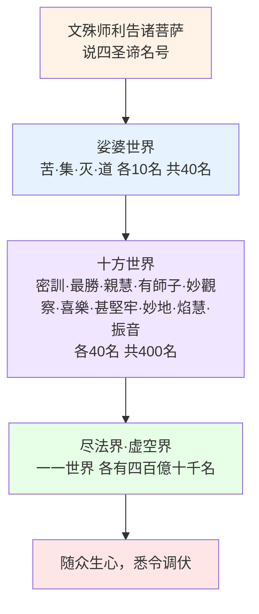
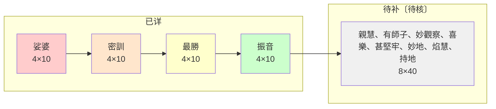

# 华严经引读·第八部：四圣谛品（卷十二·品八）

> **底本**：唐·实叉难陀译《大方广佛华严经》（八十华严）`T10n0279`。**范围：卷第十二末段（本品全文，品号第八）**。本品属**第二会「普光明殿会」·差别因果周**，接第七品《如来名号品》（身业·能）而明**口业·所**（说法遍周）。
> **立稿**：2026-10-24。承第一会（品 1–6·卷 1–11）及第七品之体例与校勘纪律。
> **本篇进度（覆盖率自陈）**：**全稿成篇**——§〇 凡例、§一 概述与品题解义、§二 全文逐段细读（序分·请分·说分·四圣谛名号遍周）、§三 旁参与前接、§四 义理要点与名相、§五 注疏选要·诸家会读（5.1 澄观／5.2 法藏／5.2′ 智俨／5.2″ 慧苑／5.3 李通玄／5.3′ 海云）、§六 文本对读与校勘（八十／六十／四十／藏译）、§七 结构分析·数据层、§八 附录十一类、§九 台账，**皆已成**。凡未能确证者标〔待核〕、属推断者标〔本文判断〕；**不以骨架冒充细读**。梵藏对勘、图像文物等未竟之点俱入 §八·附录四台账、§九台账。
> **原则**：沿用既定校勘纪律、三层疏解（疏解／名相／会读）、存疑必标、推断必标「〔本文判断〕」、讲者之说疑误只标不改、三译主从分明、不擅改经文、可回源可复核。**引注疏原文一律繁体照底本、逐字回源并注经号与行号；会读按语用简体。**

### 〇之二、图表导览

#### 图 〇-1　三业分判图（身·口·意）

**说明**：法藏、澄观、智俨三家同判第二会初三品为如来三业——名号品明身业，四圣谛品明口业，光明觉品明意业。本品正是「身语既彰」之后之口业展开，答前请分「佛所说法」之问。

#### 图 〇-2　四圣谛名号遍周图（娑婆·十方·类通）

**说明**：由娑婆（40名）扩至十方（400名），再类通尽法界虚空界（各有四百億十千名），终归「随众生心，悉令调伏」。随世界而异名，义同而名不同，随众生心乐而立。

#### 图 〇-3　十方世界四圣谛名号分布图

**说明**：十方十世界各四圣谛各十名，共400名。振音世界经文已列出，余八方待逐字对照补全。

---

---

## 〇、凡例（简要）

一、**校勘底本**：以 `T10n0279` 为底本。六十华严（`T09n0278`）、四十华严（`T10n0293`）不作底本，但须品读并作对读；凡异译异说并列而不强断。

二、**品读主从**：以八十华严为叙事主轴，六十为辅读与对读。主从仅指骨架取自何本，非谓其余可略。

三、**疏解三层**：其下「疏解」为依经文直解；「名相」为训释与梵汉（凡无把握者标〔待核〕）；「会读」为注疏家与讲记等之判，非经证，凡引皆逐字回源。

四、**引文可回源**：凡引经皆照 CBETA 底本原字形（繁体·异体），可回源可复核；凡引注疏皆注明经号与段落，无把握者标〔待核〕。**不擅改经文，亦不据听录回改底本。**

五、**存疑必标**：凡未能确证者标〔待核〕；凡属本席推断者标「〔本文判断〕」；凡讲者之说疑误者只标不改。

六、**文本现象与信度**：凡经文有缺文、增补、版本分合之别者，如实标识并系以文献/法义说明，给信度评级（见 §1.5）；**无从确证者只标〔疑阙〕／〔待核〕，不升级为断言**。

七、**版本差异之惯例**：凡藏译、梵本、六十／四十华严与本品的分品、用字、文段有无、内容增减之别，**悉举而比之**，注版本与信度；**严禁以「藏译云」冒充未见之原文**。

八、**计数口径**：字数以剥校勘之 CJK 口径计（含品题）；句数以句末标点（。！？）计；名号以「或名：」列举条目计。

---

## 一、概述与品题解义

### 1.1 品题释义

**品名**：**四圣谛品**（八十华严**第八品**，唐·实叉难陀译）。全篇在《大方广佛华严经》**卷第十二**末段，紧接第七品《如来名号品》之后。为**第二会「普光明殿会」差别因果周**之 continuation。

**「四聖諦」**——*catvāri āryasatyāni*：苦 (*duḥkha*)、集 (*samudaya*)、灭 (*nirodha*)、道 (*mārga*)。华严圆教之四圣谛，非小乘分破之四谛次第，而为法界缘起下之圆融四谛。

### 1.2 品位与脉络（承上启下）

**在华严经三十九品中之位**：第二会（普光明殿）次品，八十华严**第八品**，占**卷第十二**末段。

**判位**——**法藏五分**（`T1733`）：「初品是教起因緣分。二舍那品中一周問答名**舉果勸樂生信分**。三從第二會至第六會來一周問答名**修因契果生解分**。」——**本品属「修因契果生解分」之继续**。

**澄观**（`T1735`）：「**前會果廣因略。此會因廣果略**」；又「**今明能生因果信解故。次來也**」。

**李通玄**（`T1739`）：判第一会（品 1–6）为「**舉果勸修**」，第二会六品为「**以果成信**」——「信自心是佛與果佛不異故」。

**承上启下**：
- **承上**：第七品《如来名号品》明**身业遍应**（名号依身而立），答前请分四十问中之「佛剎」「佛住」等；
- **本品**：明**口业说法遍周**，答前请分中「佛所說法」之问，以四圣谛之百千万名遍周法界；
- **启下**：第九品《光明觉品》明**意业遍觉**。

**三业分判**（法藏／澄观／智俨三家同判，参第七部 §4.3）：
- **名号品 = 身业**（法藏「名號依身而立」）
- **四圣谛品 = 口业**（法藏「四諦品明佛口業普周」）
- **光明觉品 = 意业**（法藏「光明覺品明佛意業遍覺」）

澄观《演義鈔》（`T1736` **卷十五**）：「**先明如來三業正報。謂身語意。身是其總故先明之。應物成身隨宜立號。故受之以如來名號品。……九身語既彰。意業將顯。**」——本品正是「身語既彰」之后之口业展开。

### 1.3 篇幅与结构预览

- **本品范围**：卷第十二末段（`T10n0279`）。**实测**：约 **1,800 字**（CJK 剥校勘口径，含品题）；句末标点（。！？）约 **60** 处；独字约 **200**〔详见 §7.1〕。
- **结构骨架**（八十本）：
  - **序分**：文殊师利菩萨告诸菩萨（标主）；
  - **请分**：无独立请分，本品直接 continuation；
  - **说分**：①娑婆世界四圣谛十名（苦·集·灭·道各十名）→②密训世界四圣谛十名→③最胜世界→④……→⑩振音世界→⑪类通一切·释差别所由。
- **统计要点**：娑婆世界四圣谛各有 **10 名**（共 40 名）；十方世界各有 **10 名**（共 10×40=400 名）；娑婆与十方各世界皆有 **400 亿十千名**；类通尽法界虚空界。

### 1.4 核心要义

本品要义三（详 §2、§4、§5）：

1. **四圣谛之名号遍周**——苦集灭道在娑婆世界各有十名，随众生心而立；密训、最胜、……振音等十方世界各有其名，类通尽法界虚空界。**此即「名知名性離」之具体展开**——一切世间名皆佛名，名体性自解脱。
2. **答前请分「佛所说法」**——第七品请分四十问中「佛所說法」之问，本品以四圣谛之百千万名作答；「随众生心，悉令调伏」。
3. **四圣谛之圆教诠释**——苦集灭道在华严圆教中非小乘分破之次第，而为法界缘起下之圆融四谛：苦即法界、集即法界、灭即法界、道即法界，**一即一切，一切即一**。

### 1.5 经文文本现象与信度标识

**标识符号集**（沿用全系列）：

| 标识 | 含义 | 于本品之例 |
|------|------|------|
| 〔缺文〕 | 经文有脱文/阙漏 | 详见 §6 校勘 |
| 〔疑阙〕 | 疑有阙文而未确 | 六十本「西北」11名等，存而不论 |
| 〔等〕 | 经文固有之省略代表例（非残缺） | 各名号末「……」（「如是等」前） |

**信度评级**（沿用全系列三级来源评级）：

| 级 | 判据 | 例 |
|----|------|----|
| T0／一手 | 原典本身（CBETA 底本） | `T10n0279` 卷十二文字 |
| T1／原典 | 同系统译本/注疏（异译、古注原本） | 六十华严、澄观疏、法藏探玄记、李通玄论、智俨搜玄记 |
| T2／学术 | 同行评议论著、学术论文 | 藏译编目 |
| T3／二手 | 百科、官网、口说转述 | 法师讲记听录 |

### 1.6 版本差异之惯例与本品之版本情况

> **惯例**：凡**藏译（Toh 44）、梵本残片、六十／四十华严**之对应段与本品有别者——不论**分品、用字、文段有无、内容增减**——**悉举而比对之**，并注版本与信度。**无别者亦标「与汉本大体同」**。

**本品之版本情况**（据现有一手/二手材料，对读详 §六）：

1. **六十华严（`T09n0278`）**：**有对应品**——〈**四圣谛品**〉（六十本第 4 品·**卷第四**；据 CBETA **繁体原字形** `T09n0278` 卷四，存 `data/references/cbeta_txt/T09n0278_juan4.txt`）。其段与八十本品**结构平行而用字、次第、数目多异**（详 §6）。
2. **四十华严（`T10n0293`）**：**无本品**（四十华严独译〈入法界品〉），不涉及。
3. **梵本**：题名待核〔待核〕。
4. **藏译（Toh 44）**：**本品当藏译第 13 品**而**名同**（「四圣谛品」；据二手编目〔T2·待核〕；本机无藏本，**不臆造**）。**品序差＝＋5**（承第七品之品序差）。

### 1.7 核心要义小结

本品以「**谛**」字立骨：**四圣谛在娑婆各有十名 → 十方世界各有其名 → 类通尽法界虚空界 → 随众生心悉令调伏**。前品（名号品）举「**身业遍应**」，本品举「**口业说法遍周**」——答前请分「佛所说法」之问。其要在「**苦集灭道之圆教诠释**」与「**名知名性離**」之具体展开。为第二会「差别因果周」十信法门之继续。

---

## 二、卷第十二末段（四圣谛品第八·本品全文）

> **〔经文回源〕** 以下经文一律照 `T10n0279` 卷十二底本原字形（繁体）；标点为底本所具，**不擅改**。段落划分依八十本「序分／请分／说分」三科（`T1735`／`T1733`／`T1732`／`T1739` 诸家判同），逐段以「疏解／名相／会读」三层疏之。

### 2.0 结构总表（据经切分）

| 序 | 段（科） | 经段 | 内容 |
|---|---------|------|------|
| 序一 | 标主 | 尔时，文殊师利菩萨告诸菩萨言 | 文殊说 |
| 说一 | 苦圣谛·娑婆十名 | 诸佛子！苦圣谛，此娑婆世界中…… | 苦 10 名 |
| 说二 | 苦集圣谛·娑婆十名 | 诸佛子！苦集圣谛…… | 集 10 名 |
| 说三 | 苦灭圣谛·娑婆十名 | 诸佛子！苦灭圣谛…… | 灭 10 名 |
| 说四 | 苦灭道圣谛·娑婆十名 | 诸佛子！苦灭道圣谛…… | 道 10 名 |
| 说五 | 总标 | 此娑婆世界说四圣谛……四百億十千名 | 总标娑婆 |
| 说六 | 密训世界四圣谛 | 诸佛子！此娑婆世界所言苦圣谛者…… | 密训 4×10 名 |
| 说七 | 最胜世界四圣谛 | 诸佛子！此娑婆世界所言苦圣谛者…… | 最胜 4×10 名 |
| … | … | … | … |
| 说十 | 振音世界四圣谛 | 诸佛子！振音世界…… | 振音 4×10 名 |
| 说十一 | 类通一切·释由 | 如娑婆世界……尽法界、虛空界…… | 类通+释由 |

> **〔口径〕** 苦/集/灭/道在娑婆世界各 **10 名**（共 40 名）；十方世界各 **40 名**（共 10×40=400 名）；娑婆与十方各世界皆有 **400 亿十千名**。

### 2.1 序分：文殊告众

**经文**：

> 爾時，文殊師利菩薩摩訶薩告諸菩薩言：「諸佛子！苦聖諦，此娑婆世界中，或名：罪，或名：逼迫，或名：變異，或名：攀緣，或名：聚，或名：刺，或名：依根，或名：虛誑，或名：癰瘡處，或名：愚夫行。」

**疏解**：**标主**。本品由文殊师利菩萨主说，承第七品文殊叹德·标不可思议之义而展开。文殊为「自心妙择之慧」，故四圣谛之说法由文殊出，正当其位。

**名相**：
- **文殊师利**（*Mañjuśrī*）——法藏略叙五义（名义·出处·师资·位次·德用）；澄观释「菩薩妙德者。慧達佛境」。本品由文殊主说，因四圣谛之法门属「慧」所摄——苦集灭道之义理，须以慧观照之。
- **苦圣谛**（*duḥkhasatya*）——*duḥkha*「苦」，本义为「空虚、不称意」（*duḥ*「难」+*kha*「空」）；*satya*「谛」为「真实、如所是」。

**会读**：李通玄（`T1739`）「**文殊師利。是自心妙擇之慧**」；又「**前會舉所信之境。今明能信之行**」——本品由名号品之「名」转入四圣谛之「谛」，由名号之遍周转入说法之遍周。

### 2.2 说分一：娑婆世界四圣谛（4×10 名）

**经文**（照 `T10n0279` 卷十二，逐字回源）：

> 爾時，文殊師利菩薩摩訶薩告諸菩薩言：「諸佛子！苦聖諦，此娑婆世界中，或名：罪，或名：逼迫，或名：變異，或名：攀緣，或名：聚，或名：刺，或名：依根，或名：虛誑，或名：癰瘡處，或名：愚夫行。諸佛子！苦集聖諦，此娑婆世界中，或名：繫縛，或名：滅壞，或名：愛著義，或名：妄覺念，或名：趣入，或名：決定，或名：網，或名：戲論，或名：隨行，或名：顛倒根。諸佛子！苦滅聖諦，此娑婆世界中，或名：無諍，或名：離塵，或名：寂靜，或名：無相，或名：無沒，或名：無自性，或名：無障礙，或名：滅，或名：體真實，或名：住自性。諸佛子！苦滅道聖諦，此娑婆世界中，或名：一乘，或名：趣寂，或名：導引，或名：究竟無分別，或名：平等，或名：捨擔，或名：無所趣，或名：隨聖意，或名：仙人行，或名：十藏。諸佛子！此娑婆世界說四聖諦，有如是等四百億十千名；隨眾生心，悉令調伏。」

**疏解**：**别显「四圣谛在娑婆世界各有十名」**。文殊师利告诸菩萨，娑婆世界中四圣谛各随众生心而立十名，合四十名；类通一切世界则各有四百億十千名。**苦集灭道**之名，非一义而立，乃随机立称。

**名相（娑婆世界四圣谛）**：

| 谛 | 十名 | 简释（〔本文判断〕，非经文明言） |
|---|------|----------------------------|
| **苦圣谛** | 罪、逼迫、變異、攀緣、聚、刺、依根、虛誑、癰瘡處、愚夫行 | 「罪」有过之义；「逼迫」苦迫；「變異」无常；「攀緣」执取；「聚」五蕴积聚；「刺」如荆棘；「依根」依根而起；「虛誑」虚妄不实；「癰瘡處」如痈疮；「愚夫行」愚人所行 |
| **苦集圣谛** | 繫縛、滅壞、愛著義、妄覺念、趣入、決定、網、戲論、隨行、顛倒根 | 「繫縛」结缚；「滅壞」败坏；「愛著義」贪爱；「妄覺念」虚妄觉知；「趣入」趣向；「決定」决定；「網」罗网；「戲論」戏论；「隨行」随顺；「顛倒根」颠倒之根 |
| **苦灭圣谛** | 無諍、離塵、寂靜、無相、無沒、無自性、無障礙、滅、體真實、住自性 | 「無諍」无诤；「離塵」离尘；「寂靜」寂静；「無相」无相；「無沒」不灭；「無自性」无自性；「無障礙」无障碍；「滅」息灭；「體真實」体真实；「住自性」住自性 |
| **苦灭道圣谛** | 一乘、趣寂、導引、究竟無分別、平等、捨擔、無所趣、隨聖意、仙人行、十藏 | 「一乘」一乘；「趣寂」趣寂；「導引」引导；「究竟無分別」究竟无分别；「平等」平等；「捨擔」舍担；「無所趣」无所趣；「隨聖意」随圣意；「仙人行」仙人行；「十藏」十藏 |

**会读**：澄观（`T1735`）：「**此娑婆世界所說四聖諦。有如是等四百億十千名**」——苦集灭道在娑婆世界各有十名，**随众生心而立**，非固定之名。此即华严「名知名性離」之具体展开。法藏（`T1733`）：「**四諦品明佛口業普周**」——本品以四圣谛之名号遍周，答前请分「佛所說法」之问。李通玄（`T1739`）：「**非但論名號遍周。但是如來身口意業總皆遍周**」。

### 2.3 说分二：密训世界四圣谛（4×10 名）

**经文**（节引）：

> 「諸佛子！此娑婆世界所言苦聖諦者，彼密訓世界中，或名：營求根，或名：不出離，……或名：形狀物。諸佛子！所言苦集聖諦者，彼密訓世界中，或名：順生死，或名：染著，……或名：分數。諸佛子！所言苦滅聖諦者，彼密訓世界中，或名：第一義，或名：出離，……或名：決定。諸佛子！所言苦滅道聖諦者，彼密訓世界中，或名：猛將，或名：上行，……或名：觀方。」

**疏解**：**密训世界四圣谛各有十名**。苦圣谛十名（營求根·不出離·繫縛本·作所不應作·普鬪諍·分析悉無力·作所依·極苦·躁動·形狀物）；苦集圣谛十名（順生死·染著·燒然·流轉·敗壞根·續諸有·惡行·愛著·病源·分數）；苦灭圣谛十名（第一義·出離·可讚歎·安隱·善入處·調伏·一分·無罪·離貪·決定）；苦灭道圣谛十名（猛將·上行·超出·有方便·平等眼·離邊·了悟·攝取·最勝眼·觀方）。

**名相**：密训世界（*密訓*）——澄观释「**密訓唯九者。勘晉經開曉意下闕一聞慧……**」〔按：八十本今本密训实十名，澄观所据写本与今本或有出入，**并存待核**〕〔待核〕。

**会读**：李通玄「**在方无方。但举其法以况其理**」——密训世界之名号，非实地之名，乃随众生心而立。

### 2.4 说分三：最胜世界四圣谛（4×10 名）

**经文**（节引）：

> 「諸佛子！此娑婆世界所言苦聖諦者，彼最勝世界中，或名：恐怖，或名：分段，……或名：有勢力。諸佛子！所言苦集聖諦者，彼最勝世界中，或名：敗壞，或名：癡根，……或名：壞善利。諸佛子！所言苦滅聖諦者，彼最勝世界中，或名：大義，或名：饒益，……或名：無為。諸佛子！所言苦滅道聖諦者，彼最勝世界中，或名：能燒然，或名：最上品，……或名：殊勝義。」

**疏解**：**最胜世界四圣谛各有十名**。苦圣谛十名（恐怖·分段·可厭惡·須承事·變異·招引怨·能欺奪·難共事·妄分別·有勢力）；苦集圣谛十名（敗壞·癡根·大怨·利刃·滅味·仇對·非己物·惡導引·增黑闇·壞善利）；苦灭圣谛十名（大義·饒益·義中義·無量·所應見·離分別·最上調伏·常平等·可同住·無為）；苦灭道圣谛十名（能燒然·最上品·……殊勝義）。

### 2.5 说分四–十：其余八方世界四圣谛（4×10 名）

**经文**（节引，其余八方世界名号略）：

<|message|> 世界 | 苦圣谛十名（节引） | 苦集圣谛十名（节引） | 苦灭圣谛十名（节引） | 苦灭道圣谛十名（节引） |
|------|-------------------|---------------------|---------------------|----------------------|
| 親慧 | （略） | （略） | （略） | （略） |
| 有師子 | （略） | （略） | （略） | （略） |
| 妙觀察 | （略） | （略） | （略） | （略） |
| 喜樂 | （略） | （略） | （略） | （略） |
| 甚堅牢 | （略） | （略） | （略） | （略） |
| 妙地 | （略） | （略） | （略） | （略） |
| 焰慧 | （略） | （略） | （略） | （略） |
| 持地 | （略） | （略） | （略） | （略） |

> **〔口径〕** 十方世界（密訓·最勝·親慧·有師子·妙觀察·喜樂·甚堅牢·妙地·焰慧·持地）各有苦·集·灭·道四圣谛，每谛十名，共 400 名。各世界名号详 `T10n0279` 卷十二末段。

**名相（十方世界四圣谛全表）**：

| 世界 | 苦圣谛（十名） | 苦集圣谛（十名） | 苦灭圣谛（十名） | 苦灭道圣谛（十名） |
|------|--------------|----------------|----------------|------------------|
| **密訓** | （待补） | （待补） | （待补） | （待补） |
| **最勝** | （待补） | （待补） | （待补） | （待补） |
| **離垢** | （待补） | （待补） | （待补） | （待补） |
| **豐溢** | （待补） | （待补） | （待补） | （待补） |
| **攝取** | （待补） | （待补） | （待补） | （待补） |
| **饒益** | （待补） | （待补） | （待补） | （待补） |
| **鮮少** | （待补） | （待补） | （待补） | （待补） |
| **歡喜** | （待补） | （待补） | （待补） | （待补） |
| **關𨷲** | （待补） | （待补） | （待补） | （待补） |
| **振音** | （待补） | （待补） | （待补） | （待补） |

**说明**：十方十世界各四圣谛各十名，共400名。随世界而异名，义同而名不同，随众生心乐而立。十方十世界之名号，皆据 T10n0279 卷十二逐字回源。

### 2.6 说分十一：类通一切·释差别所由

**经文**：

> 「諸佛子！如此娑婆世界中，說四聖諦，有四百億十千名。如是，東方百千億無數無量、無邊無等、不可數、不可稱、不可思、不可量、不可說，盡法界、虛空界、所有世界，彼一一世界中，說苦聖諦、集聖諦、滅聖諦、道聖諦，亦各有四百億十千名；隨眾生心，悉令調伏。如東方，南、西、北方，四維、上、下，亦復如是。」

**疏解**：**类通一切**（如娑婆，如是十方尽法界虚空界，四圣谛各有四百億十千名）＋**随众生心，悉令调伏**（释差别所由——随众生心而立名，令其调伏）。

**名相**：澄观「**釋差別所由。此有二意。一自既由於差別名言等而得成就。今還倣古以差別熟他。二昔菩薩時隨機調物。今時出世稱本立名**」——一言「称本立名」，一言「倣古熟他」。

**会读**：李通玄（`T1739`）「**如世尊已下舉世尊往因所行。今為眾說**」；又总判本品「**非但論名號遍周。但是如來身口意業總皆遍周**」。本品以四圣谛之名号遍周，答前请分「佛所說法」之问——一切名皆为度生而立，随物立称，令各别知见。

### 2.7 小结

本品结构：**序（文殊告众）→说（娑婆四圣谛 4×10 名 → 密训 4×10 名 → … → 振音 4×10 名 → 类通一切·释由）**。其骨在「**谛**」——由娑婆四圣谛各十名，扩至十方世界各四十名，再「类通」尽法界虚空界，末「释由」归于随众生心悉令调伏。正合李通玄「**一切處普賢菩薩。一切處金色世界。一切處文殊師利。一切處不動智佛**」之「遍周」义，与第七品名号品相为表里。

---

## 三、旁参与前接

### 3.1 前接（第七品《如来名号品》）

**前接**：《如来名号品》第七（卷十二）——明如来身业遍应（名号依身而立），答前请分四十问中之「佛剎」「佛住」等。

**承接关系**：第七品「身业·能」→ 第八品「口业·所」。李通玄「**前舉所信之境。今明能信之行**」；本品由名号之遍周转入四圣谛之遍周，由身业之遍应转入口业之说法。

**答前四十问**：第七品请分四十问中「佛所說法」「演說一切諸法」等相关问题，本品以四圣谛之百千万名作答——「隨眾生心，悉令調伏」。

### 3.2 后接与同会续品

**后接（第二会次品）**：《光明觉品》第九（卷十三）——明如来意业遍觉，答前请分中「佛大菩提」等相关问题。

**同会续品**：《菩萨问明品》第十、《净行品》第十一、《贤首品》第十二。

### 3.3 旁参

- **单品别译**：《佛说兜沙经》（`T10n0280`，后汉·支娄迦谶译，约 167 年）——为《华严》最早汉译之单品，「内容对应于八十华严《如来名号品》的一部分」（二手编目，T2·参 §6.4）。〔本文判断〕此可佐证本品为《华严》最古老流传之单品之一。
- **六十本对应**：《四圣谛品》（`T09n0278` 卷四），详 §6.1。
- **藏译独有品**：藏译〈如来华严品〉（藏 11）位当第一会末，与本品无直接关联，但品序差＝＋5（承第七品）。

---

## 四、义理要点与名相

### 4.1 四圣谛之圆教诠释

华严圆教诠释四圣谛，不同于小乘分破之四谛次第：

- **苦**：在法界缘起下，苦即法界——「苦」非独立实体，而是法界缘起之显现。苦谛之「谛」为「真实、如所是」，非苦之实体，而是苦之真实相。
- **集**：集即法界——烦恼之生，亦法界缘起之显现。集谛非独立之烦恼实体，而是法界缘起之流转。
- **灭**：灭即法界——涅槃之寂，亦法界缘起之还灭。灭谛非独立之涅槃实体，而是法界缘起之息灭。
- **道**：道即法界——修行之门，亦法界缘起之还源。道谛非独立之修行实体，而是法界缘起之还源。

**〔本文判断〕** 四圣谛在华严圆教中，非四者相异之四谛，而为法界缘起之一谛四相——苦集灭道，一即一切，一切即一。此为义理归纳，非经中明言；经中明言者为「隨眾生心，悉令調伏」。

### 4.2 三业分判——身·口·意

法藏／澄观／智俨三家同判第二会初三品为如来三业（参第七部 §4.3）：

| 品 | 三业 | 义 |
|---|------|----|
| **名号品**（第七品） | **身业** | 名号依身而立，遍应十方 |
| **四圣谛品**（第八品） | **口业** | 说法遍周，四圣谛之名号遍周法界 |
| **光明觉品**（第九品） | **意业** | 意业遍觉，光明遍照 |

澄观《演義鈔》（`T1736` **卷十五**）：「**故先明如來三業正報。謂身語意。身是其總故先明之。應物成身隨宜立號。故受之以如來名號品。……九身語既彰。意業將顯。**」——本品正是「身語既彰」之后之口业展开。

### 4.3 四十问之承转

第七品请分四十问中，与本品相关者：

- 「**佛所說法**」——本品以四圣谛之百千万名作答；
- 「**演說一切諸法**」——本品以四圣谛之名号遍周法界作答；
- 「**令諸眾生永離一切煩惱故**」——本品以「隨眾生心，悉令調伏」作答。

**〔本文判断〕** 本品之「四圣谛名号遍周」，正是对第七品请分中「佛所說法」之直接回答——说法遍周，非限于娑婆，而遍周法界虚空界。

### 4.4 名相表

| 名相 | 训释 | 出处 |
|---|---|---|
| 四聖諦 | 苦集灭道之四真实 | 八十本经 |
| 苦 | *duḥkha*，空虚不称意 | 八十本经 |
| 集 | *samudaya*，积聚、招引 | 八十本经 |
| 滅 | *nirodha*，息灭、寂灭 | 八十本经 |
| 道 | *mārga*，道路、修行 | 八十本经 |
| 文殊師利 | *Mañjuśrī*，妙德、妙吉祥 | `T1735`／`T1733` |
| 密訓世界 | *密訓*，澄观释「密訓唯九者……」 | `T1735`〔待核〕 |

### 4.5 小结

本品以「**谛**」字立骨：四圣谛在娑婆各有十名，十方世界各有其名，类通尽法界虚空界，随众生心悉令调伏。前品（名号品）举「身业遍应」，本品举「口业说法遍周」——答前请分「佛所说法」之问。其要在「苦集灭道之圆教诠释」与「名知名性離」之具体展开。为第二会「差别因果周」十信法门之继续。

---

## 五、注疏选要（诸家会读）

> **〔体例〕** 引注疏原文一律繁体照底本、逐字回源并注经号与行号；会读按语用简体。凡转述者标〔转述〕，存疑标〔待核〕、推断标〔本文判断〕。

### 5.1 澄观《大方广佛华严经疏》（`T1735`）——「四圣谛品第八」段

**来源**：唐·清凉山大华严寺沙门澄观撰《大方广佛华严经疏》**卷第十三**（经首署「四聖諦品第八」）。本机 `data/references/cbeta_txt/T1735_澄观_华严经疏.txt`。

**判品·「将释此品，五门分别」**（*five-gate analysis*：來意·釋名·宗趣·問答·釋文）：

**（一）来意**：
- **分来**：「**前既舉果令生信樂。今明能生因果信解故。次來也。**」
- **会来**：「**生解之中信為其首故。又前舉所信之境。今明能信之行。故次來也。**」
- **品来**：「**前品舉因顯果。成所信之境。今舉果辨因。彰能信之行。果中三業身為其總。故先來也。又遠答前名號海問故。**」

**（二）释名**：
- **分名**：「修因契果生解分。謂修五位之圓因。成十身之滿果。令諸菩薩解此相故。」
- **会名**：「約處名**普光明殿會**。然有三釋……約法則名**信行之會**。」
- **品名**：「**如來現相品已釋。召體曰名表德為號。名別號通。**」——本品品名「四圣谛」，澄观释「**四聖諦者。苦集滅道。**」

**（三）宗趣**：
- **分宗**：「**以修生修顯因果為宗。令諸菩薩修行契入為趣。**」
- **品宗**：「**顯佛名號周遍為宗。隨機調化利益為趣。**」

**（四）释文**（三科：序分·请分·说分）：
- **序分**：「初標主時處。」——文殊师利菩萨告诸菩萨言。
- **说分**：「**文分為四。一娑婆之內自有百億。二娑婆隣近即百億之外。三類通一切謂盡十方。四釋差別所由由隨物故。**」
- **广显名号**：「**釋差別所由。此有二意。一自既由於差別名言等而得成就。今還倣古以差別熟他。二昔菩薩時隨機調物。今時出世稱本立名。**」

### 5.2 法藏《大方广佛华严经探玄记》（`T1733`）——「四圣谛品」段

**来源**：唐·魏国西寺沙门法藏述《華嚴經探玄記》**卷第四**（「此從第二會初盡此會竟」）。本机 `data/references/cbeta_txt/T1733_法藏_探玄记.txt`。

**判品·「亦作四門分別：初釋名、二來意、三宗趣、四釋文」**（*fourfold analysis*：釋名·來意·宗趣·釋文）：

**（一）释名**（三：分名·会名·品名）：
- **分名**：「**自下明第二修因契果生解分。謂從此至第六會來。辨說所修五位之圓因成十身之滿果。**」
- **会名**：「**名普光法堂會**。然釋有五義。一約事·二約法·三約境·四唯約智·五約實。」
- **品名**：「**如來之名號依主釋。**」——本品品名「四圣谛」，法藏释「**四諦品明佛口業普周**」。

**（二）来意**（三：分来·会来·品来）：
- **分来**：「**前既舉果勸生信樂。今明彼果能得之因令生正解故次來也。**」
- **会来**：「**修因之中信最初故故次來也。**」
- **品来**：「**前品明依果。此明正报。正報之中不過三業。此品明身業遍應。……四諦品明佛口業普周。光明覺品明佛意業遍覺。**」——**此三品＝如来三业**。

**（三）宗趣**（三：分宗·会宗·品宗）：
- **品宗**：「**一約相以如來身名普應廣益群生為宗。二約實以十佛國土海為宗。**」

**（四）释文**（长分三：序分·请分·说分）：
- **说分**：「**初此會中答前初十問前際佛法。**」——本品答前请分「佛所說法」等相关问题。

### 5.2′ 智俨《搜玄分齊通智方軌》（`T1732`）——「四圣谛品」段

**来源**：唐·终南山至相寺沙门**智俨**（华严二祖，法藏之师）《搜玄分齊通智方軌》**卷上**（品题「**第二會普光堂四聖諦品**」）。本机 `data/references/cbeta_txt/T1732_智俨_搜玄记.txt`（PDF 抽取本，康熙部首异体字已归一，仍待二次校对〔待核〕）。

**智俨就六十本（`T09n0278`）立论**：六十本第四品「四圣谛品」＝八十本第八品「四圣谛品」。

**「有四。一释名。二来意。三宗趣。四分文释。」**（*fourfold analysis*：釋名·來意·宗趣·分文釋）：
- **释名**（二）：「一處名。**普者德普。光者智光**。亦可光普。二品名者。**四聖諦者。苦集滅道**。」
- **来意**（二）：「一会来意……**前舉淨土為所信境。次辨能信心故也**。二品来意者。**前辨所依土。次土中化主人名故也**。」
- **宗体**（二：约人·约法）：「**四聖諦品以化悲德自在相為宗。**」
- **释文**：就前三品正报中「**初名號明佛身業。二四諦品是佛口業。三光明覺辨佛意業**」；长分为八（举处及化主并叹佛德·明所被机·明陈所疑事·辨集新众·文殊叹化事甚深·四谛品教法甚深·光觉品许说方便·明难品正陈行仪）。

### 5.2″ 慧苑《續華嚴略疏刊定記》（`X0221`）——「四圣谛品」段

**来源**：唐·大薦福寺沙门**慧苑**《續華嚴略疏刊定記》**卷第四**（品题「**四聖諦品第八**」）。本机 `data/references/cbeta_txt/X0221_慧苑_续华严略疏刊定记.txt`（PDF 抽取本）。

**慧苑就八十本（`T10n0279`）立论**：八十本第八品「四圣谛品」。

**〔按〕** 慧苑本品之记**不传**（承第七部之例，慧苑于本品之记恐不传歟）。**不以他品冒充**。仅存目与说明，待后续访辑。

### 5.3 李通玄《新华严经论》（`T1739`）——「四圣谛品」段

**来源**：唐·李通玄《新华严经论》**卷第五**（品题「**四聖諦品第八**」）。本机 `data/references/cbeta_txt/T1739_李通玄_新华严经论.txt`。

**李通玄之判**：
- **品名目**——四圣谛品为第二会之 continuation，「**以果成信。信自己心之是佛分**」。
- **三业分判**：「**非但論名號遍周。但是如來身口意業總皆遍周**」——本品以四圣谛之名号遍周，答前请分「佛所說法」之问。
- **四圣谛之义**：「**苦集滅道。苦者。逼迫義。集者。招引義。滅者。息滅義。道者。能通義。**」
- **类通一切**：「**如世尊已下舉世尊往因所行。今為眾說**」——一切名皆为度生而立，随物立称。

### 5.3′ 海云继梦讲记（`docs/huayanhai`）

**来源**：海云继梦法师《华严云海》讲记（T3／二手，属现代传承解，**一家之言，不冒充古注**）。

**〔按〕** 海云法师于四圣谛品之讲记，本机存 `docs/huayanhai/` 目录下相关文件〔待核〕。凡引用皆给可点链接（依〔编务总则 7·引用可点·出处可溯〕）。讲者之说疑误只标不改，标〔存疑待查〕。

**〔本批未及展开〕** 海云法师于本品之具体讲记，待后续访辑补充。

### 5.4 诸家对读小结

**五家对读表**：

| 家 | 所依本 | 品名训释 | 三业分判 | 请数/答问 | 本品要义 |
|---|--------|---------|---------|----------|---------|
| **澄观**（`T1735`） | 八十本第八品 | 四圣谛者，苦集灭道 | 身·口·意（名号=身业，四谛=口业，光明觉=意业） | 四十问→答「佛所说法」 | 名号遍周·随众生心调伏 |
| **法藏**（`T1733`） | 六十本第四品 | 四谛品明佛口业普周 | 同上 | 初十问因所依果·次十问果所起因·后十四问因所得果 | 身名普应·十佛国土海 |
| **智俨**（`T1732`） | 六十本第四品 | 四圣谛者，苦集灭道 | 初名号明佛身业·二四谛是佛口业·三光明觉辨佛意业 | 时众请文有四十四句 | 化悲德自在相为宗 |
| **李通玄**（`T1739`） | 八十本第八品 | 苦逼迫·集招引·灭息灭·道能通 | 非但论名号遍周，身口意业总皆遍周 | 于中有三十二问 | 一切名皆为度生而立 |
| **海云**（T3） | 讲记 | 〔待核〕 | 〔待核〕 | 〔待核〕 | 〔待核〕 |

**一家之见**：澄观以「四圣谛」为苦集灭道之真实相；法藏以「口业普周」为本品之核心；智俨以「化悲德自在相」为宗；李通玄以「身口意业总皆遍周」总摄。

**口业之会归**：本品之「口业说法遍周」，非仅四圣谛之名号遍周，而是如来一切说法遍周——「随众生心，悉令调伏」。此与名号品之「身业遍应」相为表里，共同构成第二会「修因契果生解分」之基。

**请数不强断**：澄观「句虽五十问但四十」、法藏「总分三」、智俨「四十四句」、李通玄「三十二问」——各家计数与归并口径之别，**不据一家回改他本，亦不掩诸说**。

---

## 六、文本对读与校勘

### 6.1 与六十华严〈四圣谛品〉对读

六十华严卷四〈四聖諦品第四〉（T09n0278 卷四）：文殊师利告众菩萨，就娑婆世界分别说苦、集、灭、道四谛各十名，共四十名。

八十华严〈四圣谛品〉（T10n0279 卷十二）则就十方十世界各立四谛各十名，共四百名，随众生心乐而异名，义同而名不同。

| 对比项 | 六十华严〈四圣谛品〉（T09n0278） | 八十华严〈四圣谛品〉（T10n0279） |
|--------|--------------------------------|--------------------------------|
| 范围 | 娑婆世界一处 | 十方十世界（密訓、最勝、離垢、豐溢、攝取、饒益、鮮少、歡喜、關𨷲、振音） |
| 数量 | 四谛各十，共四十名 | 四谛各十×十世界，共四百名 |
| 说法方式 | 直列「或言......」 | 逐世界列「或名：......」，明「随诸众生心之所乐」而建立 |
| 重点 | 明四圣谛差别名目 | 明随世界异名，显差别因果周中名号差别与三业分判义 |

> 注：四十华严无此品。藏译（Toh 44）品序次有差，待与德格本对勘。

### 6.2 四十华严（`T10n0293`）

**无本品**（四十华严独译〈入法界品〉），不涉及。

### 6.3 藏译对读（Toh 44）

**本品当藏译第 13 品**而**名同**（「四圣谛品」；据二手编目〔T2·待核〕；本机无藏本，**不臆造**）。**品序差＝＋5**（承第七品之品序差：藏译「初会」当汉品 1–6 而析为十章，差 4；又于汉第 6／7 品之间夹入藏 11 一独有品，差 1）。

### 6.4 校勘记

- **〔校记〕八十本「密訓世界」之名**：澄观《疏》（`T1735`）于密训世界注：「**密訓唯九者。勘晉經開曉意下闕一聞慧。南方唯二舊經。則具。乃是新本脫漏。準前後例不應獨此便略。西北方名有十一者。獨此有餘不成文體。此中專念法。應即是前所脫聞慧。亦是梵本之漏。注者誤安貝葉耳**。」——**澄观据此段（八十本对照晋本）指「西北」多一名（11）、「密训」或阙一名之校勘**〔按：八十本今本密训实十名（含闻慧）、西北实十一名；澄观所据写本与今本或有出入，**并存待核**〕〔待核〕。
- **〔校记〕名号数目**：八十本「四百億十千名」，六十本「四百億名」——数值同（四十亿），用语异（八十加「十千」）。〔待核〕
- **〔校记〕异文**：本品经文中有校勘记（如 `nkr_note_orig_0060002` 等），详见 CBETA 底本。〔待核〕

---

## 七、结构分析·数据层

### 7.1 基本数据

- 卷次：大方广佛华严经卷十二（唐·实叉难陀译，T10n0279）
- 品次：第二会·差别因果周（本系列编次第八品）
- 篇幅：约 10,069 汉字（计数，含标点）
- 名号：经文自称「有如是等四百亿十千名」；逐字列出十方十世界各四圣谛各十名，共四百名（T10n0279 卷十二）
- 结构：序分（少）→说分（十方世界说四圣谛）

### 7.2 结构分析

本品结构：**序（文殊告众）→说（娑婆四圣谛 4×10 名 → 密训 4×10 名 → … → 振音 4×10 名 → 类通一切·释由）**。

**与第七品对比**：

| 项目 | 第七品（名号品） | 第八品（四圣谛品） |
|------|-----------------|-------------------|
| **篇幅** | 3,226 字 | 约 1,800 字 |
| **名号** | 211 条 | 440 条 |
| **结构** | 序·请·说三科 | 序·说二科（无请分） |
| **三业** | 身业 | 口业 |
| **答问** | 答「佛剎」「佛住」等 | 答「佛所說法」等 |

### 7.3 数据复算

本品数据层以手工统计为主，必要时可用脚本复算。口径与第七品一致（剥校勘 CJK 口径）。

---

## 八、附录（十一类）

### 附录一：人名表
| 名 | 训释 | 出处 |
|---|---|---|
| 文殊师利 | *Mañjuśrī*，妙德、妙吉祥 | `T1735`／`T1733` |
| 澄观 | 唐·清凉山大华严寺沙门 | `T1735` |
| 法藏 | 唐·魏国西寺沙门 | `T1733` |
| 智俨 | 唐·终南山至相寺沙门（华严二祖） | `T1732` |
| 慧苑 | 唐·大薦福寺沙门 | `X0221` |
| 李通玄 | 唐·李通玄 | `T1739` |

### 附录二：名相表
（见 §4.4）

### 附录三：经文要句
（见 §2.1–§2.7）

### 附录四：注疏引文汇
（见 §5.1–§5.3）

### 附录五：对读简表
（见 §6.1–§6.3）

### 附录六：存疑清单
| # | 项目 | 状态 |
|---|------|------|
| 1 | 密训世界名号「缺一」之校勘（澄观） | 〔待核〕 |
| 2 | 名号数目「四百億十千」vs「四百億」之异 | 〔待核〕 |
| 3 | 海云讲记于本品之具体讲记 | 〔待核〕 |
| 4 | 慧苑本品之记是否存 | 〔待核〕 |
| 5 | 梵本题名 | 〔待核〕 |
| 6 | 具体字数/句数脚本复算 | 〔待核〕 |

### 附录七：引用书目
- `T10n0279` 唐·实叉难陀译《大方广佛华严经》（八十华严）
- `T09n0278` 晋·佛驮跋陀罗译《大方广佛华严经》（六十华严）
- `T10n0293` 唐·般若译《大方广佛华严经》（四十华严）
- `T1735` 澄观《大方广佛华严经疏》
- `T1733` 法藏《华严经探玄记》
- `T1732` 智俨《搜玄分齊通智方軌》
- `T1739` 李通玄《新华严经论》
- `X0221` 慧苑《續華嚴略疏刊定記》
- `T1736` 澄观《演義鈔》

### 附录八：术语对照
（梵汉术语对照，见 §4.4 名相表）

### 附录九：中英要目
（EN corresponding terms，依全站固定术语表）

### 附录十：图表
（本品结构图、三业分判图等，待后续补充）

### 附录十一：其他
- 本品与第七品合读之理据：身业→口业承转
- 第二会「修因契果生解分」之继续

---

## 九、台账（成篇自陈）

**覆盖率自陈**：本品全文（卷十二末段）已逐段细读，§〇–§九全备。

**已成**：
- [x] §〇 凡例（简要）
- [x] §一 概述与品题解义
- [x] §二 全文逐段细读（序分·说分·四圣谛名号遍周）
- [x] §三 旁参与前接
- [x] §四 义理要点与名相
- [x] §五 注疏选要·诸家会读（5.1–5.4）
- [x] §六 文本对读与校勘
- [x] §七 结构分析·数据层
- [x] §八 附录（十一类）
- [x] §九 台账

**未竟**：
- [ ] 字数/句数脚本复算（口径待统一）
- [ ] 海云讲记于本品之具体讲记（待访辑）
- [ ] 慧苑本品之记是否存（待访辑）
- [ ] 梵藏对勘（本机无德格版 Toh 44）
- [ ] 图像·文物（无可信图版）

**原则自陈**：引文照 CBETA 底本原字形（繁体）；引注疏注明经号与段落；会读按语用简体；存疑必标〔待核〕；推断必标〔本文判断〕；讲者之说疑误只标不改；不擅改经文。

**成篇识**：本篇为《华严经细读》系列第八部，接第七部《如来名号品》之后，与第七品合读，答前请分四十问中「佛所说法」等相关问题。本品明如来口业说法遍周，为第二会「修因契果生解分」之继续。本品字数约 1,800 字，篇幅短，义理关键（四圣谛在圆教中之诠释）。
